# Frame: live projects and articles lists, and the blog move to mnemra.dev

**Date:** 2026-11-18 · **Status:** locked (Peter, 2026-11-18: "Accept and lock", after three Cerberus and Warden review rounds) · **Task:** #4853
**Intake:** `docs/intent/live-lists-and-blog-move.md`, locked at tag `brief/live-lists-and-blog-move/intent-locked`, commit `73e4ffb2045798a0c260e984fad289db45d754fa`.
**Modulation:** cold-start. The intent changes architectural surfaces: runtime outbound transport (HC-2, HC-17), a new store (HC-19), and retired deploy-time controls (HC-11).

## Stage 2a — Elicitation

This section is the architectural-direction input record. `### 2a-R — Answers` records how each slot was answered. Below it, SH-1 to SH-5 and the `SLOT-n` entries are the proposal as made, kept so that its rejected alternatives stay on the page. The template's `{{P-XXX}}` placeholder form is not used, because `P-` prefixes canon principle ids. Intake ids (SC, HC, NG, OQ, FQ, RL, intake D-A to D-C) refer to the locked intake.

### 2a-R — Answers, 2026-11-18

**Peter's rulings** (quoted as relayed by the coordinator; inherited):
- **SLOT-1: "reqwest, direct".** The same version and TLS features as rig-core's 0.13.2.
- **SLOT-2: "quick-xml".** 0.42.0, plain `Reader`; pin the 0.42 minor.
- **SLOT-3b: "Every start".**
- **SLOT-4: "New table".** Migration 008, a strict table with one row per list.
- **SLOT-6: "Node script + tests".** The departure from P-RustDefault is granted for this CI-only check.
- **Numeric character references in feed text: "Reject the post".**
- **A literal `<` in prose: "Reject the post".** `>` and `&` are allowed.
- **"Use url directly".** Declared at the lockfile's version (`url` 2.5.8, `Cargo.lock:3154-3155` on main at `4a445a5`, measured).

**Peter's rulings on Frame review round 1, 2026-11-18** (quoted as relayed; inherited):
- **"Same account, accept".** mnemra.dev and peter.manahan.io share one Cloudflare account. Warden's R1-W-1 is accepted as above-bar risk RISK-3 in `docs/RISK-REGISTER.md` (written by the lead). Compensating controls held by Peter: hardware-key 2FA on the account, a mnemra.dev-zone-scoped deploy token, an `EDGE_AUTH_TOKEN` rotation path.
- **"Fly secret switch".** The break-glass is a per-list Fly secret that makes the server ignore that list's stored copy at start, so the list reads as no data yet. It adds no HTTP surface. It replaces fix-at-source-and-restart as the primary route; that stays as the ordinary path (D-10).
- **"Yes, time must advance".** This answers ESC-1, option B as corrected: a separate post-deploy check job that goes red unless both lists' refresh times are later than the deploy job's start (D-9). *As amended by LD-6: the anchor is the serving process's start, not the deploy job's start (Cerberus R3-M-1).*

**Lead decisions on Frame review round 1 (level 4; inherited):**
- **LD-1, the item cap is newest-N.** The first N `<item>`s are collected and validated, and the rest are not. This replaces "fail at N+1" (Cerberus R1-M-10). *As amended by ESC-6:* the rest are still parsed for well-formedness and closure (Cerberus R2-6).
- **LD-2, unknown children.** Unknown channel-level children are discarded, not a feed failure. An unknown item-level child rejects that post. The grammar is carried to mnemra.dev #4858 (Cerberus R1-M-6, Warden TH-19).
- **LD-3, the refresh interval** is a fraction of 24 hours, at most 8 hours (Cerberus R1-M-5).
- **LD-4, FQ-2 is parked, not deferred.** `flyctl ips list` shows ingress IPs only; outbound traffic is inferred to leave through Fly's shared egress (Cerberus R1-M-4).
- **LD-5, RD-1 is re-decided on main `4a445a5`** (see RD-1).

**Lead decisions on Frame review round 2 (level 4; inherited):**
- **LD-6, the post-deploy anchor** (Warden F-5, Cerberus R2-3). The freshness read also reports the serving process's start time. The post-deploy predicate is: each list's refresh time is later than the serving process's start, and no later than now plus skew. Both times come from one clock. *Corrected rationale (Cerberus R3-M-3):* on its own, the predicate could be satisfied by the old release. What excludes the old release is the ordering. `needs: deploy` runs the check only once the deploy job has finished and the new process is serving. A new release whose start refresh fails leaves rows older than its start, so the check goes red.
- **LD-7, the switch's value grammar** (Warden F-2, Cerberus R2-4). `LIVE_LISTS_DISABLED` is parsed against the allowlist `{projects, articles}`, comma-separated; empty means none. An unknown token disables both lists and logs at `error`; refusing to start is the rejected alternative. The refresher reads the disabled set and never fetches or writes a disabled list. PROC-5's delete happens before any refresher write.
- **LD-8, PK-1 widened.** The monthly review also checks RISK-3's controls: hardware-key 2FA, the mnemra build token's zone scope, that the `EDGE_AUTH_TOKEN` rotation runbook exists, and that the account's members and API tokens match the register baseline.

**Taken by the lead as proposed (level 4; inherited):**
- SLOT-3: the in-process tokio refresher.
- SLOT-5: `GET /api/lists/freshness`, public, timestamps only, `no-store`, behind the origin lock and the rate limiter.
- SLOT-7: `GET /api/lists/projects`.
- SLOT-8: no retry within a refresh.
- SLOT-9: break-glass is fix at the source and restart. *Superseded as primary by "Fly secret switch" (D-10).*
- Item cap: every `<item>` counts, skipped ones included; a feed over the cap fails the whole fetch and keeps the last good copy. *Superseded by LD-1 (newest-N).*

**Measured by the lead, 2026-11-18 (inherited):**
- `https://mnemra.dev/rss.xml` returns 200 `application/xml` with no redirect. Resolves the HC-17 risk below.
- Fly runs 1 machine and 1 volume. Resolves the single-machine risk below, as an assumption that announces itself: only Peter can add a machine.
- `reqwest` 0.13.2 enters only through rig-core 0.37.0.
- Not yet measured: FQ-2, the GitHub budget from Fly's egress.

**Research input:** Sage, `~/work/brain/research/folio/2026-11-18-rust-rss-parser-for-folio.md` (read in this dispatch). Warden's security lens on it, summarised by the lead: quick-xml alone, under conditions C1 to C8 (inherited; folded into D-3 below).

### SH-1 — System boundary

**Inside:** the folio server, one Rust process in `cmd/server/` and `libs/site-core/`, on one Fly machine behind Cloudflare. It does four things:
- fetches both lists;
- validates them;
- holds and persists the last good copy;
- serves `/projects`, both prompts, the timestamp read and the article redirects.

Also inside:
- the SvelteKit pages the server serves;
- one new scheduled GitHub Actions workflow, the daily check (HC-15);
- one new job in `.github/workflows/deploy.yml`, the post-deploy check (D-9; Cerberus R2-1).

**Outside, called by the server:**
- the GitHub REST API at the two fixed URLs (HC-2);
- https://mnemra.dev/rss.xml, served by Cloudflare (RL-2);
- Anthropic, unchanged.

**Outside, calling in:**
- visitors through Cloudflare;
- the daily check and the post-deploy check, through Cloudflare like any visitor;
- Fly's health check, unchanged.

**No longer part of the system:**
- the deploy job's fetch step;
- the Node fetch script;
- the release machine's `check-projects` run;
- the static list file.

### SH-2 — Component map

Architectural altitude. Module names are illustrative; the spec fixes paths.

| ID | Component | Responsibility | Home and reuse |
|---|---|---|---|
| CMP-1 | **Source seam** | One interface with one operation: fetch the bytes at one of HC-2's three URLs, under HC-17 and HC-18's policy. The policy sits above an injected transport, and tests replace the transport, not the policy (D-1; Cerberus R1-M-7). The only place this feature makes outbound HTTP; chat and fit still call Anthropic through rig-core, unchanged. | New, in `site-core`. |
| CMP-2 | **GitHub adapter** | Calls CMP-1 for each owner, pages as HC-2 states, then applies R-4 (reject the fetch on any bad element), R-3 (exclusions) and R-2's zero-repo failure. It yields a validated projects list, or a failed fetch. | New Rust port of the rules in `frontend/scripts/fetch-projects.mjs`. It emits the Data Model document that `libs/site-core/projects_list.rs` already validates, and builds `ProjectsList` by passing that document through the module's `parse`. That module is a fail-closed validator: it denies unknown fields, checks the object shape, the rejected class, the name pattern and the order, and the type can only be built by validation. What it keeps and retires is listed once, in D-2 (Cerberus R1-L-4). |
| CMP-3 | **Feed adapter** | Calls CMP-1, parses RSS with the parser chosen at SLOT-2, applies HC-14 and D-A per post, skips and logs bad posts, and yields a validated article list. A feed that is empty, unreadable, or has no valid post is a failed fetch (OQ-9). | New. It applies R-4's rejected class. On main at `4a445a5`, only `is_invisible` is shared (`pub(crate)`, `libs/site-core/ai/types.rs:18`); `is_rejected` is private to `projects_list.rs` (`:503`), so sharing it is a spec item (Cerberus R1-L-2). It emits an articles document with its own `fetched_at`, and gives it a typed parse that does for articles what `projects_list::parse` does for projects: unknown fields denied, HC-14 and D-A applied per post. |
| CMP-4 | **Store** | One row per list holding that list's validated document, whose `fetched_at` is the last-successful-refresh time (HC-19; intake review H-2). It is read once at start and validated again through the same parse that produced it: `projects_list::parse` for projects, and the articles parse of CMP-3 for articles. A row that fails is treated as no data yet, with no time. Shape at SLOT-4. **Owns the switch's delete:** at start, before any refresher write, the row of a disabled list is deleted (D-10, ESC-7). | New table, by migration (SLOT-4). |
| CMP-5 | **Held copy** | The in-memory current copy of each list, plus its time, shared through app state. Readers take a snapshot per request. A copy is replaced only after it has been validated and persisted (HC-19). | New. It replaces the `ProjectsList` that the server loads once at startup today (`cmd/server/main.rs:85-89`). |
| CMP-6 | **Refresher** | Runs one refresh of both lists: CMP-2 and CMP-3, then CMP-4, then CMP-5. Only one refresh runs at a time. Each list advances or keeps its copy on its own (D-B). A failure, a rejection or a skipped post is logged at `warn` (SC-17). The whole run sits under HC-18's refresh bound. Triggers at SLOT-3. **Honours the switch:** it reads the disabled set and never fetches or writes a disabled list (D-10, LD-7). | New. |
| CMP-7 | **Readers** | The prompt builder (`libs/site-core/ai/context.rs`) reads CMP-5 for both prompts (HC-12, HC-20). The `/projects` page reads it through the list route (SLOT-7). The timestamp read (SLOT-5) reports three times: CMP-5's two refresh times, and the serving process's start time (LD-6; Cerberus R3-M-2). | `context.rs` changes its input from the startup `ProjectsList` to a snapshot of CMP-5. The articles section loses its `articles` table read and its full `content`. |
| CMP-8 | **Redirect** | A server route answering SC-10's path set with a 301 to a constant (HC-13). It sits ahead of the SPA fallback, because the fallback answers 200 to unknown paths (`libs/site-core/static_files.rs:196-197`). | New route. The SvelteKit `/articles` routes, `/api/articles` and the admin article editor are removed (HC-7). |
| CMP-9 | **Checks** | Two checks.<ul><li>The daily check, PROC-11: a scheduled workflow that reads twice, judges the second read (SC-20), holds `contents: read` and references no secret (D-C).</li><li>The post-deploy check, PROC-13: a job in `deploy.yml` with `needs: deploy` that judges the refresh times against the serving process's start (D-9, LD-6).</li></ul>Form at SLOT-6. | A new workflow file for the daily check, and a new job in `deploy.yml`. Both sit inside the R-7 pin and checkout controls (SC-19, SC-21; Cerberus R2-1). |

**FQ-1 answered by the map (for Peter to confirm):** one mechanism for both lists — one seam (CMP-1), one store (CMP-4), one held copy (CMP-5), one refresher (CMP-6) and one timestamp read — with two adapters (CMP-2, CMP-3). The adapters differ because the validation rules were ruled differently:
- projects reject the whole fetch on any bad element (projects Frame D-4, kept by SC-5);
- the feed skips bad posts (FQ-5, ruled).

*Anchor: V-Consistency, "The same problem gets the same shape — within a surface, across surfaces, and across projects"; the divergence is stated in one sentence and rests on two rulings.*

### SH-3 — What is retired, and what replaces it

| Retired (intake HC-11, OQ-2) | Replaced by |
|---|---|
| The deploy job's fetch step and `frontend/scripts/fetch-projects.mjs` | CMP-1 and CMP-2, in the server, at runtime |
| The release command `./folio check-projects` (`fly.toml:36`) and its age bound | The post-deploy check (D-9), which requires both lists to refresh under the new release. Freshness is CMP-6's job, and staleness is watched by the daily check (48 hours). |
| The startup refusal on a bad or missing list (`cmd/server/main.rs:85-89`) | CMP-4's re-validation on load. A bad or missing row means no data yet (SC-6, SC-16); the server still starts |
| The static `/projects.json` and its `no-cache` rule (R-11, `libs/site-core/static_files.rs:37`) | The list route of SLOT-7, serving CMP-5 |
| The prompt's read of the `articles` table and its full text | CMP-5's article list: title, summary, link and date |

### SH-4 — Trust boundaries (architectural; the typed DFD is written at 2b)

- **TB-A, Fly machine → api.github.com.** New, outbound. Untrusted repo text comes in. Controls: HC-17, HC-18, CMP-2's fail-closed validation.
- **TB-B, Fly machine → mnemra.dev (Cloudflare).** New, outbound. Untrusted feed text comes in. Controls: HC-17, HC-18, CMP-3's per-post validation.
- **TB-C, process → SQLite on the volume.** The persisted copy outlives deploys and rollbacks (AS-3). Control: re-validation on load (CMP-4).
- **TB-D, server → Anthropic.** Existing; now also carries feed text. Controls: HC-20's preamble and one line per entry (FQ-13: no review lens covers it).
- **TB-E, internet → Cloudflare → origin.** Existing; gains the list route, the timestamp read and the redirect. All three sit behind the origin lock, which wraps the fallback too. Only the two routed reads sit behind the global rate limiter: per `libs/site-core/app.rs`'s layer note on main, the rate-limit layer does not wrap the fallback. The redirect is fallback-level (D-7), so it is not rate-limited, like today's static `/projects.json` (projects Frame KG-9). Corrected per Cerberus R1-M-9.
- **TB-F, GitHub Actions runner → production.** CMP-9 reads the public timestamp endpoint with no secret (D-C).
- **Retired:** the runner → Fly build-context path for the list file, and the release machine's read of it.

### SH-5 — Cross-cutting decisions proposed

- **Storage.**
  - CMP-4 is the only persistent state this feature adds. The `articles` and `projects` tables are not touched (NG-2, HC-7).
  - Writes go: validate, then persist in one transaction, then swap CMP-5. If the persist fails, the held copy and its time stay as they were, and the failure is logged as a failed refresh.
  - Shape at SLOT-4.
- **Transport and client policy.**
  - One client, built once, used only by CMP-1.
  - HTTPS only, TLS verified against the system roots (the image installs `ca-certificates`, `Dockerfile:78`). Redirects are refused.
  - Calls go only to HC-2's URLs, with `&page=N` built on the fixed GitHub URL.
  - Each request has connect and total timeouts and a body byte cap. A whole refresh has a refresh bound. GitHub requests carry a `User-Agent` and no `Authorization` header (SC-13).
  - The client crate is SLOT-1.
- **Refresh lifecycle.**
  - At start, CMP-4 loads and CMP-5 is served from the first request (HC-1).
  - CMP-6 then runs off the critical path, so health is answered within the 15-second grace period (`fly.toml:24`) whatever the sources do.
  - While the machine runs, CMP-6 repeats on an interval of at most 8 hours (LD-3; Cerberus R2-6). No request handler starts a refresh (NG-13).
  - Triggers are SLOT-3; retries are SLOT-8.
- **Observability.**
  - A `warn` log line for each failed or rejected refresh and each skipped post (SC-17).
  - An `info` line for each successful refresh, with per-list counts.
  - The public timestamp read with `no-store` (HC-15, SLOT-5).
  - CMP-9's red runs, daily and post-deploy, which GitHub emails to Peter (RL-1, D-9).
  - Whether CMP-9 itself stops running is a parked known gap (FQ-11).
- **Failure modes**, each with its behaviour:
  - Source unreachable, timed out, non-200, or 403/429 from GitHub's rate limit: failed fetch. The copy is kept and the time does not advance.
  - Body over the cap, unparseable, page cap hit, or a truncated list: failed fetch, as above.
  - Projects with any rejected repo, or an owner with zero repos: failed fetch (SC-5).
  - Feed with some bad posts: those posts are skipped and logged, the rest update, and the time advances.
  - Feed empty, or with no valid post: failed fetch (OQ-9).
  - Persist fails: the old copy stays in memory, and the failure is logged.
  - Stored row invalid at start: no data yet for that list, with its time reported missing.
  - Machine stops mid-refresh: the transaction leaves the old row or the new one.
  - A refresh is already running: the new trigger joins it or is dropped (single flight).

### Open slots for Peter

Level per the intake's decision levels: 3 means recommend and wait for approval (a new dependency, for example); "durable" means expensive to undo.

- **SLOT-1 — HTTP client (level 3, new direct dependency).**
  - **Recommend:** `reqwest` as a direct dependency of `site-core`, pinned to the version and features rig-core already brings: `0.13.2` in `Cargo.lock`, with `rustls`, `hyper-rustls` and `rustls-platform-verifier`.
    - The expected closure growth is zero crates, because it is already in the tree. That is an inference from `Cargo.lock`, to verify with `cargo tree` at the spec.
    - *Anchor: V-Simplicity, "Choose the smallest mechanism that solves the problem."*
    - Cost: a direct `reqwest` must stay version-compatible with rig-core's, or a second copy enters the build.
  - **Rejected:**
    - **rig-core's `http_client` re-export:** no new direct dependency, but it couples list fetching to the AI library's API, so an AI-library upgrade can break the fetch.
    - **`hyper-util`'s client directly:** already in the tree, but redirect refusal, timeouts and TLS setup are hand-written.
    - **`ureq`:** a new closure and a blocking API.
- **SLOT-2 — RSS/XML parser (level 3, new dependency). Needs research, not a choice yet.**
  - No crate in `Cargo.lock` today parses XML. Candidates for a bounded comparison: `quick-xml`, `rss` (an RSS 2.0 model over `quick-xml`), `feed-rs` (RSS, Atom and JSON Feed), and `roxmltree` (a read-only DOM). I hold no verified facts about their DTD or entity handling, licences or maintenance.
  - Criteria, each from the intake or the repository:
    - refuses DTDs and entity expansion (HC-18);
    - lets CMP-3 detect markup, entities and CDATA in title and summary, so they can be rejected rather than stripped (HC-14, FQ-15);
    - licence on `deny.toml`'s allowlist;
    - maintenance and advisory history (`audit.yml`);
    - closure size.
  - **Recommend:** dispatch Sage for that comparison; lock at 2b against its output.
- **SLOT-3 — Refresh scheduler (level 4).**
  - **Recommend:** an in-process tokio task, spawned after CMP-4 loads. It runs one refresh at start, then repeats on an interval of at most 24 hours, single flight. The spec sets the interval value. *Superseded: the interval is at most 8 hours (LD-3; Cerberus R3-L-1).*
    - Precedent: the rate-limit purge task, `tokio::spawn` with `tokio::time::interval`, `cmd/server/main.rs:149-155`.
    - *Anchor: V-Simplicity, as SLOT-1; V-Consistency, as SH-2.*
  - **Rejected:**
    - **A Fly scheduled machine:** a second process needing the volume, which attaches to one machine.
    - **A GitHub Actions cron calling a refresh endpoint:** NG-13 forbids that endpoint.
    - **An external cron service:** outside existing infrastructure.
  - **SLOT-3b — refresh at every start.**
    - **Recommend:** always, as OQ-7's ruling reads ("served at cold start, and is then refreshed").
    - **Alternative, only if FQ-2's budget fails:** skip the start refresh while the held copy is younger than a floor. Each wake from a visitor (ACTOR-1) costs 2 GitHub requests against 60 per hour per IP. This alternative would strain OQ-7's wording, so it goes to Peter before any design breaks NG-9.
- **SLOT-4 — Store shape (durable: schema).**
  - **Recommend:** a new `STRICT` table by migration `008`:
    - one row per list;
    - the list name as primary key, checked to the two names;
    - the list's validated document as one JSON payload, whose `fetched_at` is the only copy of the last-successful-refresh time, with no separate time column;
    - written by upsert in one transaction.
    - *Anchor: HC-19 ("one row per list, overwritten on success, no history"); V-Consistency with `site_config`'s `STRICT` key-value shape (`migrations/005_site_config.sql`); V-Simplicity for the single time: under D-B the time advances exactly when a new copy is persisted, so the payload's `fetched_at` and the time are one fact, and a second copy could only drift.*
  - **Rejected:**
    - **Rows in `site_config`:** no migration, but it mixes cached untrusted text with the runtime configuration that `site_config` is the source of truth for (project `CLAUDE.md`), which has a different lifecycle.
    - **One row per repo or post:** HC-19 rules it out.
- **SLOT-5 — Timestamp read: path and auth (level 4 for the path; auth is settled).** *Superseded in part by LD-6: the read also returns the process start time, which this proposal omits (Cerberus R3-L-1).*
  - **Auth is public:** RL-1 says the check "needs no secret" and D-C forbids one.
  - **Recommend:** `GET /api/lists/freshness`, in one `/api/lists/` family with SLOT-7 (names for Peter's word). It returns each list's last-successful-refresh time, or null when missing, with `Cache-Control: no-store`. It sits behind the origin lock and the global rate limiter.
  - **Rejected:**
    - **Folding into `/api/health`:** Fly's health check reads it, so a stale list could fail health and cycle machines, and `/api/health` is exempt from the origin lock.
    - **Admin-only:** needs a secret.
- **SLOT-6 — Daily check form (level 3: departs from P-RustDefault).**
  - Shared by every option: a scheduled workflow, daily cron plus `workflow_dispatch`, holding `permissions: contents: read` and no secret (D-C).
  - **Recommend:** a Node script tested by vitest, which carries SC-20's five [T] cases.
    - Precedent: Peter granted Node for the CI fetch (projects Frame D-9), and CI checks already run as Node, for example `frontend/scripts/check-csp.mjs`.
    - P-RustDefault reads "If you have a good reason to leave Rust, stop and push the decision up", so this is pushed up, not taken.
  - **Alternatives:**
    - **Rust,** as a `folio` subcommand built in the job: the canon default, at the cost of a build on every daily run.
    - **Inline shell:** rejected, because SC-20 needs tested logic.
  - **Option, not a recommendation, as proposed** (ESC-1 later recommended it, and Peter ruled the corrected form; Cerberus R1-L-3): the same script could also run as a post-deploy step beside the existing health, origin-closure and CSP checks in `.github/workflows/deploy.yml`. *Superseded, and its claim was false (Cerberus R1-H-3).* The proposal said a fetcher regression would then go red at the deploy. It would not: the refresh time is persisted, so right after a deploy the 48-hour predicate passes on the time the previous release wrote. Peter ruled the corrected form: "Yes, time must advance" (2a-R, D-9).
- **SLOT-7 — What serves `/projects` its list (answers FQ-8; level 4).**
  - **Recommend:** `GET /api/lists/projects`, in the same `/api/lists/` family as SLOT-5, returning CMP-5's projects snapshot with `Cache-Control: no-store`. The links stay composed from owner and name (R-13); the page reads the route instead of the static file. *Anchor: V-Consistency — the two routes serve the same held copy, so they take one shape.*
  - The intake requires that the no-data-yet case lets the page render SC-6's note; the response contract for that is the spec's.
  - **Alternative:** `/api/projects`. D-3 of the projects Frame removed an older `/api/projects` with a different contract; no client of it remains, but reusing the path invites reading the new route as the old one.
- **SLOT-8 — Retry after a failure (answers FQ-7; level 4).**
  - **Recommend:** no retry inside a refresh. The next attempt is the next interval tick or the next start. A 403 or 429 from GitHub counts as a failed fetch.
    - *Anchor: V-Simplicity; it also spends no GitHub budget (FQ-2).*
  - **Alternative:** a bounded retry with backoff inside the refresh bound, which spends budget.
- **SLOT-9 — Break-glass for a stored entry that is valid but wrong (answers FQ-9; level 4).** *Superseded as primary by D-10, the Fly secret switch (Cerberus R3-L-1).*
  - **Recommend:** correct the text at its source (the GitHub description or the mnemra.dev post), then restart the machine. The start refresh overwrites the row.
    - The source is the truth and the store is its cache, so no new admin surface is added.
    - The runbook text is written at 2b.
  - **Alternatives:**
    - **An admin endpoint that clears one list:** a new authenticated write surface.
    - **SQL through `fly ssh console`:** whether the image carries a SQLite client is unverified.

### Intake FQ disposition

| FQ | Disposition |
|---|---|
| FQ-1 | Answered by SH-2: one mechanism, two adapters. For Peter to confirm. |
| FQ-2 | Parked (LD-4), with PK-1's cadence; backstops are the post-deploy check and SC-20. Coupled to SLOT-3b. |
| FQ-3, FQ-4, FQ-6 | 2b threat-model items. The actor set extensions and the re-signature, for Peter at Frame exit. |
| FQ-5 | Ruled in the intake; carried by CMP-3. |
| FQ-7 | SLOT-8. |
| FQ-8 | SLOT-7. |
| FQ-9 | D-10 (the Fly secret switch) and its runbook. |
| FQ-10 | SLOT-1 and SLOT-2. |
| FQ-11 | 2b known-gaps list, including the human cadence for the parked daily-check gap. |
| FQ-12 | 2b typed DFD, from SH-4. |
| FQ-13 | 2b. Recorded as structural, with no lens. |
| FQ-14 | Spec item. Recommend: only SC-10's path set redirects; other forms keep today's handling. |
| FQ-15 | Spec items, except the refresh bound's interaction with FQ-7, which SLOT-8 answers (no retries inside the bound). |

### Risks the shape raises against the locked intake

None of these makes an intake item unsatisfiable; each needs a check.

- **HC-17 refuses redirects.** If https://mnemra.dev/rss.xml or either GitHub URL answers with a redirect, every fetch of it fails. The GitHub URLs were measured at 200 (EV-3); the feed URL's status was not recorded in the intake. To measure before 2b locks. **Resolved by measurement (2a-R):** the feed answers 200 with no redirect.
- **SLOT-3b and FQ-2.** Always refreshing at start spends 2 GitHub requests on every wake. If the measured budget does not hold, the only relief that keeps NG-9 is the floor alternative, which strains OQ-7's wording; that goes to Peter. **Superseded:** FQ-2 is parked, not deferred (LD-4, D-5).
- **SLOT-1's version coupling.** A direct `reqwest` must move with rig-core's, or the build carries two copies.
- **The shape assumes one machine with one volume.** CMP-4, CMP-5, SLOT-3, SLOT-4 and HC-15's one time per list all depend on it. Two machines would mean two stores, two refresh clocks, and a daily check that reads whichever machine answered. Grounds: Warden's asset AS-4, "a 256mb single machine" (inherited), and the volume mount `site_data` at `/app/data` (`fly.toml:13-15`). The running machine count is unmeasured here; checking it needs Fly tooling, so it is for the lead. **Resolved by measurement (2a-R):** 1 machine, 1 volume; carried as KG-1-style self-announcing assumption (KG-14).

## Data flow diagram

Typed DFD for the live design, drafted by the architect and retyped after Warden's R1-B-1. Processes are `PROC-n`, as in the projects Frame, because `P-` prefixes canon principle ids. Ids are this Frame's own. The EE, PROC, DS, DF, TB, TH and KG ids are also used by the projects Frame, which stays live while #4837 is held, so `EE-3` here is not the projects Frame's `EE-3`. Every cross-reference to that Frame says "projects Frame" (Cerberus R1-L-6). The stage reference's `P-*` process form is not used, for the collision stated above, following the projects Frame's precedent. Every edge has one id, and every flow ends on an element. SH-4's provisional TB-A to TB-F map as follows: TB-A → TB-4, TB-B → TB-5, TB-C → DS-1 inside TB-3, TB-D → TB-6, TB-E → TB-1 and TB-2, TB-F → TB-8 and TB-11 (Cerberus R3-L-2).

```mermaid
flowchart LR
  subgraph TB_7["TB-7 visitor browser"]
    EE_1["EE-1 Visitor browser"]
    PROC_9(["PROC-9 /projects page render, text only"])
    PROC_10(["PROC-10 chat pane render, markdown + DOMPurify"])
  end

  subgraph TB_1["TB-1 Cloudflare edge (folio)"]
    EE_4["EE-4 Cloudflare edge"]
  end

  subgraph TB_4["TB-4 GitHub REST API"]
    EE_2["EE-2 GitHub REST API, plus repo-text authors"]
  end

  subgraph TB_5["TB-5 mnemra.dev, same Cloudflare account (RISK-3)"]
    EE_3["EE-3 mnemra.dev rss.xml, plus feed author and build chain"]
  end

  subgraph TB_6["TB-6 Anthropic, prompt egress"]
    EE_5["EE-5 Anthropic API"]
  end

  subgraph TB_8["TB-8 runner: daily check job"]
    PROC_11(["PROC-11 daily check, node, no secret"])
  end

  subgraph TB_10["TB-10 runner: deploy job"]
    PROC_12(["PROC-12 setup-flyctl + flyctl deploy"])
    DS_5[("DS-5 GH Actions secret FLY_API_TOKEN")]
  end

  subgraph TB_11["TB-11 runner: post-deploy check job"]
    PROC_13(["PROC-13 post-deploy check, node, no secret"])
  end

  EE_8["EE-8 GitHub notification email to Peter"]

  subgraph TB_9["TB-9 operator workstation"]
    EE_6["EE-6 Operator workstation"]
  end

  subgraph TB_12["TB-12 Fly platform"]
    EE_7["EE-7 Fly platform API: deploy, machines, secrets"]
    DS_6[("DS-6 Fly log sink")]
  end

  subgraph TB_3["TB-3 Fly machine, holds app secrets; 1 machine, 1 volume"]
    PROC_1(["PROC-1 outbound client, policy over transport (CMP-1)"])
    PROC_2(["PROC-2 GitHub adapter + projects_list::parse (CMP-2)"])
    PROC_3(["PROC-3 feed adapter, quick-xml Reader (CMP-3)"])
    PROC_4(["PROC-4 refresher: validate, persist, swap (CMP-6)"])
    PROC_5(["PROC-5 startup loader, re-validate, switch (CMP-4)"])
    DS_1[("DS-1 SQLite live-lists table")]
    DS_2[("DS-2 SQLite site content")]
    DS_3[("DS-3 held copy in memory (CMP-5)")]
    DS_4[("DS-4 app env: secrets + LIVE_LISTS switch")]
    subgraph TB_2["TB-2 Fly origin, trusts the holder of EDGE_AUTH_TOKEN"]
      PROC_6(["PROC-6 fallback: /articles 301, static, SPA (CMP-8)"])
      PROC_7(["PROC-7 /api/lists/projects + /api/lists/freshness"])
      PROC_8(["PROC-8 chat/fit handlers + prompt builder"])
    end
  end

  PROC_1 -->|"DF-1 GET, fixed URLs"| EE_2
  EE_2 -->|"DF-2 repo JSON"| PROC_1
  PROC_1 -->|"DF-3 GET rss.xml"| EE_3
  EE_3 -->|"DF-4 feed XML"| PROC_1
  PROC_1 -->|"DF-5 GitHub bytes"| PROC_2
  PROC_1 -->|"DF-6 feed bytes"| PROC_3
  PROC_2 -->|"DF-7 projects document"| PROC_4
  PROC_3 -->|"DF-8 articles document"| PROC_4
  PROC_4 -->|"DF-9 upsert"| DS_1
  PROC_4 -->|"DF-10 swap"| DS_3
  DS_1 -->|"DF-11 rows at start"| PROC_5
  PROC_5 -->|"DF-12 re-validated copy"| DS_3
  EE_1 -->|"DF-13 HTTPS"| EE_4
  EE_4 -->|"DF-14 origin request"| PROC_6
  EE_4 -->|"DF-15 origin request"| PROC_7
  EE_4 -->|"DF-16 origin request"| PROC_8
  DS_3 -->|"DF-17 snapshot"| PROC_7
  PROC_7 -->|"DF-18 projects JSON, no-store"| PROC_9
  DS_3 -->|"DF-19 snapshot"| PROC_8
  DS_2 -->|"DF-20 site content"| PROC_8
  PROC_8 -->|"DF-21 prompt"| EE_5
  EE_5 -->|"DF-22 model output"| PROC_8
  PROC_8 -->|"DF-23 reply stream"| PROC_10
  PROC_6 -->|"DF-24 301 or SPA"| EE_1
  PROC_11 -->|"DF-25 two freshness reads"| PROC_7
  PROC_13 -->|"DF-26 freshness reads after deploy"| PROC_7
  PROC_11 -->|"DF-27 red run"| EE_8
  PROC_13 -->|"DF-28 red run"| EE_8
  DS_5 -->|"DF-29 FLY_API_TOKEN, Deploy step"| PROC_12
  PROC_12 -->|"DF-30 image + deploy API"| EE_7
  EE_6 -->|"DF-31 manual deploy, restart, secret set/unset"| EE_7
  EE_7 -->|"DF-32 secrets and switch into env"| DS_4
  EE_7 -->|"DF-33 machine start"| PROC_5
  DS_4 -->|"DF-34 switch read at start"| PROC_5
  DS_4 -->|"DF-35 app secrets"| PROC_8
  PROC_4 -->|"DF-36 summary + bounded per-post lines"| DS_6
  DS_6 -->|"DF-37 fly logs"| EE_6
  PROC_5 -->|"DF-38 delete disabled list row"| DS_1
  PROC_7 -->|"DF-39 refresh times + process start, no-store"| PROC_11
  PROC_7 -->|"DF-40 refresh times + process start, no-store"| PROC_13
  DS_4 -->|"DF-41 disabled set"| PROC_4
```

**External entities**

| ID | Entity |
|---|---|
| EE-1 | Visitor browser |
| EE-2 | GitHub REST API, plus repo-text authors |
| EE-3 | mnemra.dev `rss.xml`, served by Cloudflare from the same account as folio's edge (RISK-3), plus the feed author and mnemra.dev's build chain |
| EE-4 | Cloudflare edge in front of folio |
| EE-5 | Anthropic API |
| EE-6 | Operator workstation |
| EE-7 | Fly platform API: deploy, machines, secrets |
| EE-8 | GitHub notification email to Peter, the alert path for a red run |

**Processes**

| ID | Process | Component |
|---|---|---|
| PROC-1 | Outbound client: client policy over an injected transport | CMP-1 |
| PROC-2 | GitHub adapter: R-4, R-3, R-2, then `projects_list::parse` | CMP-2 |
| PROC-3 | Feed adapter: quick-xml plain `Reader` under D-3 | CMP-3 |
| PROC-4 | Refresher: validate, persist, swap; supervised, single flight; skips disabled lists | CMP-6 |
| PROC-5 | Startup loader: read the switch, delete a disabled list's row, read DS-1, re-validate, fill DS-3 | CMP-4, CMP-5 |
| PROC-6 | Fallback: `/articles` 301 ahead of the static service and the SPA fallback | CMP-8 |
| PROC-7 | `/api/lists/projects` and `/api/lists/freshness` (refresh times and the process start time), routed | CMP-7 |
| PROC-8 | Chat and fit handlers, prompt builder | CMP-7 |
| PROC-9 | `/projects` page render, in the browser | — |
| PROC-10 | Chat pane render, in the browser | — |
| PROC-11 | Daily check, on the runner | CMP-9 |
| PROC-12 | Deploy job, on the runner | — |
| PROC-13 | Post-deploy check job, on the runner | CMP-9 |

**Data stores**

| ID | Store |
|---|---|
| DS-1 | SQLite live-lists table (migration 008), one row per list, persisted across deploys and rollbacks |
| DS-2 | The rest of SQLite: site content, with the `articles` table now unread |
| DS-3 | Held copy in memory |
| DS-4 | The app's environment: Fly secrets, plus the per-list disable switch (D-10) |
| DS-5 | GitHub Actions secret `FLY_API_TOKEN`, Deploy step only |
| DS-6 | Fly log sink |

**Data flows**

| ID | From | To | Carries |
|---|---|---|---|
| DF-1 | PROC-1 | EE-2 | HTTPS GET at the two fixed GitHub URLs, `&page=N`, no `Authorization`, `Accept-Encoding: identity` |
| DF-2 | EE-2 | PROC-1 | repo JSON, untrusted |
| DF-3 | PROC-1 | EE-3 | HTTPS GET `https://mnemra.dev/rss.xml`, `Accept-Encoding: identity` |
| DF-4 | EE-3 | PROC-1 | feed XML, untrusted |
| DF-5 | PROC-1 | PROC-2 | GitHub bytes within the body cap |
| DF-6 | PROC-1 | PROC-3 | feed bytes within the body cap |
| DF-7 | PROC-2 | PROC-4 | validated projects document |
| DF-8 | PROC-3 | PROC-4 | validated articles document |
| DF-9 | PROC-4 | DS-1 | upsert, one transaction |
| DF-10 | PROC-4 | DS-3 | swap, only after DF-9 succeeds |
| DF-11 | DS-1 | PROC-5 | rows read at start |
| DF-12 | PROC-5 | DS-3 | re-validated copy, or no data yet |
| DF-13 | EE-1 | EE-4 | HTTPS |
| DF-14 | EE-4 | PROC-6 | origin request + `X-Folio-Edge-Auth` (fallback) |
| DF-15 | EE-4 | PROC-7 | origin request + `X-Folio-Edge-Auth` (routed, rate-limited) |
| DF-16 | EE-4 | PROC-8 | chat or fit POST + `X-Folio-Edge-Auth` |
| DF-17 | DS-3 | PROC-7 | snapshot |
| DF-18 | PROC-7 | PROC-9, through EE-4 | projects JSON, `no-store` |
| DF-19 | DS-3 | PROC-8 | snapshot for both prompts |
| DF-20 | DS-2 | PROC-8 | site content |
| DF-21 | PROC-8 | EE-5 | prompt, with repo and feed lines under their preambles |
| DF-22 | EE-5 | PROC-8 | model output |
| DF-23 | PROC-8 | PROC-10, through EE-4 | reply stream |
| DF-24 | PROC-6 | EE-1, through EE-4 | 301 to the constant, or static or SPA |
| DF-25 | PROC-11 | PROC-7, through EE-4 | two public freshness reads |
| DF-26 | PROC-13 | PROC-7, through EE-4 | freshness reads after the deploy |
| DF-27 | PROC-11 | EE-8 | red run, mailed by GitHub |
| DF-28 | PROC-13 | EE-8 | red run, mailed by GitHub |
| DF-29 | DS-5 | PROC-12 | `FLY_API_TOKEN`, Deploy step env only |
| DF-30 | PROC-12 | EE-7 | image upload and deploy API |
| DF-31 | EE-6 | EE-7 | manual deploy, machine restart, `fly secrets set` or `unset` |
| DF-32 | EE-7 | DS-4 | secrets and the disable switch into the machine's environment |
| DF-33 | EE-7 | PROC-5 | machine start |
| DF-34 | DS-4 | PROC-5 | the disable switch, read at start |
| DF-35 | DS-4 | PROC-8 | app secrets (Anthropic key, `ADMIN_PASSWORD`, `EDGE_AUTH_TOKEN`) |
| DF-36 | PROC-4 | DS-6 | per-refresh summary line, plus bounded per-post lines (index and reason code) |
| DF-37 | DS-6 | EE-6 | `fly logs` |
| DF-38 | PROC-5 | DS-1 | delete the row of a list named by the disable switch (D-10, ESC-7) |
| DF-39 | PROC-7 | PROC-11, through EE-4 | freshness response: both refresh times and the serving process's start time (LD-6), `no-store` (added for Cerberus R1-L-5) |
| DF-40 | PROC-7 | PROC-13, through EE-4 | freshness response: both refresh times and the serving process's start time (LD-6), `no-store` (added for Cerberus R1-L-5) |
| DF-41 | DS-4 | PROC-4 | the disabled set, parsed per LD-7; a disabled list is never fetched or written |

**Trust boundaries**

| ID | Boundary | Encloses | Trust direction | Crossing flows |
|---|---|---|---|---|
| TB-1 | Internet → Cloudflare (folio) | EE-4 | TB-2 trusts what EE-4 forwards with the edge token; nothing trusts EE-1 | DF-13, DF-14, DF-15, DF-16, DF-18, DF-23, DF-24, DF-25, DF-26, DF-39, DF-40 |
| TB-2 | Cloudflare → Fly origin | PROC-6, PROC-7, PROC-8 | trusts the holder of `EDGE_AUTH_TOKEN` (RISK-3: the same account holds mnemra.dev) | DF-14, DF-15, DF-16, DF-17, DF-18, DF-19, DF-20, DF-21, DF-22, DF-23, DF-24, DF-25, DF-26, DF-35, DF-39, DF-40 |
| TB-3 | Fly machine, holds app secrets | PROC-1 to PROC-5, DS-1 to DS-4, and TB-2 | trusts EE-7; trusts nothing from TB-4 or TB-5 until PROC-2 or PROC-3 validates it, and DS-1 only after PROC-5 re-validates it | DF-1, DF-2, DF-3, DF-4, DF-14, DF-15, DF-16, DF-18, DF-21, DF-22, DF-23, DF-24, DF-25, DF-26, DF-32, DF-33, DF-36, DF-39, DF-40 |
| TB-4 | Fly → GitHub REST API | EE-2 | untrusted in; GitHub receives no credential | DF-1, DF-2 |
| TB-5 | Fly → mnemra.dev | EE-3 | untrusted in; mnemra.dev receives no credential | DF-3, DF-4 |
| TB-6 | Server → Anthropic | EE-5 | Anthropic trusts the API key; its output is untrusted to PROC-10 | DF-21, DF-22 |
| TB-7 | Server → visitor browser | EE-1, PROC-9, PROC-10 | the browser renders server text as text, or as sanitized markdown | DF-13, DF-18, DF-23, DF-24 |
| TB-8 | Runner, daily check job | PROC-11 | the job holds no secret and trusts only what it reads | DF-25, DF-27, DF-39 |
| TB-9 | Operator workstation → Fly | EE-6 | EE-7 trusts Peter's Fly credential | DF-31, DF-37 |
| TB-10 | Runner, deploy job | PROC-12, DS-5 | EE-7 trusts `FLY_API_TOKEN` | DF-30 |
| TB-11 | Runner, post-deploy check job | PROC-13 | the job holds no secret | DF-26, DF-28, DF-40 |
| TB-12 | Fly platform | EE-7, DS-6 | TB-3 trusts it (ACTOR-7, out) | DF-30, DF-31, DF-32, DF-33, DF-36, DF-37 |

The crossing column is derived, not read off the diagram. A flow crosses a boundary when exactly one end of one of its hops is inside it. A flow marked "through EE-4" takes a hop through EE-4, and TB-2's elements count as inside TB-3. DS-1 sits inside TB-3 but outlives releases. A row written before a deploy or a rollback is read after it (AS-3), which is why PROC-5 re-validates it.

## Operating constraints

Each cites the edge in `canon/constraint-edges.md` it rests on, or the principle file where the table has no row.

- **OPC-1 — Layered input controls** (P-SecurityLayered specializes V-Security). Each of D-3's conditions is independently load-bearing. A later layer, such as the prompt preamble, never stands in for an earlier one, such as validation.
- **OPC-2 — Least authority** (P-LeastAuthority specializes V-Security). The server holds no GitHub credential (NG-9). Both check jobs hold `contents: read` and no secret (intake D-C). The refresher has no endpoint (NG-13), and the break-glass adds none (D-10).
- **OPC-3 — One injected seam, below the policy** (P-TestableByDesign specializes V-Quality and V-Maintainability). CMP-1's transport is the collaborator injected for testability (HC-16). The policy above it runs in every test.
- **OPC-4 — Guarantees held by tests** (P-GuaranteeByMechanism specializes V-Quality and V-Observability):
  - every hazard of D-3 has a negative fixture;
  - the workflow controls are held by the R-7 test (SC-19, SC-21);
  - the retirements are held by SC-18's search.
- **OPC-5 — The freshness signal means what it reports** (P-TrustworthySignal specializes V-Observability):
  - the time advances only on a successful refresh (intake D-B);
  - the read is `no-store`;
  - the daily check judges a second read;
  - the post-deploy check requires each list's refresh time to be later than the serving process's start and no later than now plus skew (LD-6; Cerberus R3-M-1).
- **OPC-6 — Instrumented at first run** (P-InstrumentBefore specializes V-Observability). The summary log, the freshness read and both checks ship with the change.
- **OPC-7 — Lock the intrinsic contracts** (P-LockContract specializes V-Simplicity, V-MigrationCost and V-Consistency). **Ruled at ESC-5** ("Accept all four").
  - **Locked:** CMP-1's contract (bytes for one fixed URL, under the client policy), DS-1's stored document shapes (D-4), and D-3's hazard-level properties.
  - **Behind them, free to vary:** the parser and its API mapping. No parser type crosses CMP-3's output (Cerberus R1-M-1).
- **OPC-8 — A swap reaches one module** (P-MinBlastRadius specializes V-Maintainability). A parser change touches CMP-3 only; a client change touches CMP-1's transport only.
- **OPC-9 — Rust by default; one departure, granted** (P-RustDefault, anchors V-Simplicity, V-Consistency and V-Quality, per its file; no row in the edges table). The server-side work is Rust. Peter granted Node for the CI check scripts (2a-R). This is also the Quality ⇄ Cost row's cost override, surfaced (Escalated decisions, walk).
- **OPC-10 — No new ecosystem** (P-StackDiscipline specializes V-Simplicity and V-Consistency). Node already runs in CI (`frontend/scripts/check-csp.mjs`). Both check scripts run with `node` alone, with no `npm ci`.
- **OPC-11 — Park with a cadence** (P-Defer specializes V-Simplicity and V-Reversibility). FQ-2 is parked (LD-4), as are PK-1 and PK-2, each with a cadence.
- **OPC-12 — Keep the decision space** (P-PreserveDecisionSpace specializes V-Honesty and V-Decomposition). Every direction below carries its rejected alternatives; superseded text in 2a is annotated, not deleted.

## Locked directions

Proposed for Frame exit; none is locked until the gate. "Projects Frame D-n" means `docs/intent/projects-from-github-frame.md`; "intake D-A to D-C" means the locked intake's lead decisions. Each control names the in-scope actor it stops (Warden R1-B-3). TLS verification is ACTOR-8's exclusion precondition, not a control.

**Projects Frame directions this Frame supersedes** (Cerberus R1-L-6), recorded here so neither Frame is read as current on them:
- **Superseded:**
  - D-1 (CI fetch and the release-command age check), by D-1, D-5 and D-8 here;
  - D-2 (one file at `frontend/static/projects.json`), by D-4, D-6 and D-7;
  - D-8 (`GITHUB_TOKEN`), by D-1 (no token);
  - D-9 (the Node fetch script), by D-2 and D-8;
  - QA-1 and QA-2 (fresh fetch per deploy, deploy fails when GitHub is down), by D-5 and D-9.
- **Amended:**
  - QA-3 (one file read by page and prompt) now reads "one held copy" (D-6);
  - D-7's "the deploy log names the repo" now means the refresh summary log (D-3, C6).
- **Still in force:** D-3, D-4, D-5 and D-6, and QA-4 and QA-5.

| ID | Direction | Anchor | Rejected, and why |
|---|---|---|---|
| D-1 | **Runtime fetch through one client.** CMP-1 is a client policy above an injected transport; the real transport is `reqwest`, a direct dependency at rig-core's version and TLS features (0.13.2, rustls). **The policy:**<ul><li>HTTPS only, TLS verified;</li><li>only HC-2's three URLs, with `&page=N` built on the fixed GitHub URLs; page N+1 is requested only while page N's `Link` header carries `rel="next"`, and a fetch that reaches the page cap (HC-18) is rejected (Cerberus R1-L-1);</li><li>no default headers: no `Authorization`, `x-api-key` or `X-Folio-Edge-Auth` on any request (TH-18);</li><li>`Accept-Encoding: identity`, and no decompression crate (none is in `Cargo.lock` on main);</li><li>per-request connect and total timeouts, plus a total deadline on the body read;</li><li>a body byte cap that rejects over the limit, counting the bytes received;</li><li>one refresh bound;</li><li>a GitHub `User-Agent`.</li></ul>**Stops:** redirects refused stops ACTOR-4 (TH-6); the caps stop ACTOR-4 (TH-5); no default headers stops a leak to ACTOR-4's host (TH-18). | Peter: "reqwest, direct". OPC-2, OPC-3, OPC-8. Intake HC-2, HC-17, HC-18. | The rig-core `http_client` re-export; `hyper-util` directly; `ureq` (SLOT-1). Following GitHub's `Link` URL, which admits URLs the code did not enumerate (intake HC-2). Injecting above the policy, which leaves the policy untested (Cerberus R1-M-7). |
| D-2 | **Projects validation reuses `projects_list.rs`.** PROC-2 ports R-4, R-3 and R-2 from `frontend/scripts/fetch-projects.mjs` and builds `ProjectsList` through `projects_list::parse`. **Kept:** `parse`, `parse_fetched_at`, the validated types, and a future-time bound. At load, a document whose `fetched_at` is ahead of the clock by more than the skew allowance is no data yet (Warden R1-W-4). The bound is stated once, in D-4. **Retired:** `load(path)`, `check_fetched_at_age`, `check_fetched_at_age_now`, `MAX_AGE_BEHIND`. Any rejected repo, or an owner with zero repos, fails the whole fetch. **Stops:** ACTOR-4 and ACTOR-6. | OPC-1; V-Consistency, one validator for the page and the prompt; intake SC-5, SC-8, D-B. | A second validator for the live path, which would mean two definitions of a valid list. |
| D-3 | **Feed parsing: hazard-level properties.** quick-xml 0.42.x, plain `Reader`, the 0.42 minor pinned. These properties lock here; their mapping to quick-xml events, methods and configuration is carried to the spec (Cerberus R1-M-1). **C1, fields are text only.** Inside a field, only text and the five named entities are allowed. Any element, CDATA, comment, processing instruction, declaration or DOCTYPE inside a field rejects the post. *Stops ACTOR-4, ACTOR-6.* **C2, parse errors fail the feed.** Any parse error fails the whole feed, with no resuming. The document must close with `</channel>` and `</rss>`, followed only by whitespace before the end. *Stops ACTOR-4, ACTOR-6.* **C3, no DTDs, namespaces or attribute parsing.** A DOCTYPE or a processing instruction anywhere fails the feed. Attributes are never parsed. A field tag that carries anything after its name rejects the post, with no trimming. Element names match by exact qualified name, so `atom:link` is never `link`. *Stops ACTOR-4.* **C4, references.** A numeric character reference rejects the post (Peter: "Reject the post"). Exactly the five named entities are accepted; any other name rejects the post. A decoded `<` rejects the post (Peter: "Reject the post"); `>` and `&` are allowed. A duplicate or empty field rejects the post. *Stops ACTOR-4, ACTOR-6.* **C5, field checks on decoded text.** R-4's rejected class and the length caps (in code points) apply to the decoded field, and R-4 also applies to the raw link. The link is parsed with `url`, a direct dependency (Peter: "Use url directly"). The parsed form must have:<ul><li>scheme `https`;</li><li>host exactly `mnemra.dev`;</li><li>no port and no userinfo;</li><li>a path under `/blog/` with a remainder;</li><li>no query and no fragment;</li><li>a serialized form identical to the raw link;</li><li>a length under a cap.</li></ul>The serialized form is stored. *Stops ACTOR-4.* **C6, caps and logs.** The byte cap applies before the parse. A depth cap bounds nesting. The item cap is newest-N: the first N `<item>`s are taken (LD-1); the remainder is parsed for well-formedness and closure, without being collected or validated (ESC-6, lead decision). Each refresh writes one summary line, never rate-limited, with counts by reason code; per-post lines carry an index and a reason code only, and are bounded (Cerberus R1-M-8). *Stops ACTOR-4.* **C7, nothing depends on the parse.** Startup never depends on a successful parse, nothing panics on feed data, and the sink renders text only. *Stops ACTOR-4, ACTOR-6.* **C8, a negative fixture per hazard,** plus a positive control built from real generator output. This is the mechanism, blocking for the spec. **Recovery after a rejected post** tracks depth to that `<item>`'s end, so a nested `<item>` never yields a post. **Structure and discarded content** (Warden F-7):<ol><li>A discarded subtree is skipped by depth, to its matching end tag.</li><li>`<item>` is recognised only as a direct child of the single `<channel>`, and `<channel>` only as the sole element child of `<rss>`. A second `<channel>` fails the feed.</li><li>C2, C3, the depth cap and the byte cap bind inside discarded subtrees: a DOCTYPE or PI anywhere fails the feed, and attributes are never parsed. No decode runs on discarded content.</li><li>Directly under `<rss>`, `<channel>` and `<item>`, outside any field or discarded child, CDATA, a comment or non-whitespace text is a named failure. It fails the feed at `<rss>` or `<channel>` level and rejects the post at `<item>` level. The "only whitespace" rule is scoped to these direct-text positions.</li><li>Nothing from discarded content reaches the logs, DS-1 or the prompt.</li></ol> **The document grammar outside the four fields** is RD-2, as amended by LD-2. | Peter: "quick-xml". Warden C1 to C8 (inherited). OPC-1, OPC-4. Sage: quick-xml is "the only candidate that hands folio every construct FQ-15 needs to see as a distinct item". | **roxmltree:** decodes entities and folds CDATA into text, and fails the whole feed on one undeclared entity. **`rss` and feed-rs:** strip child elements and comments with no signal, the opposite of HC-14's reject-not-strip rule, and put `chrono` in the shipped graph (`rss` with default features; feed-rs always). **A hand-rolled tokenizer.** **Fail at N+1** (superseded by LD-1, for its growth cliff). |
| D-4 | **Store.** Migration `008`: a `STRICT` table with one row per list. The primary key is the list name, checked to `projects` and `articles`. Each row holds the list's validated document as JSON; its `fetched_at` is the only copy of the last-successful-refresh time. The table is written by upsert in one transaction, read once at start, and re-validated through the same parse that produced it. A row that fails is no data yet, with its time missing. **Document shapes (Cerberus R1-M-3):**<ul><li>projects: the existing Data Model document;</li><li>articles: `fetched_at` plus, per post, title, summary, link in its serialized form, and publication date.</li></ul>Both timestamps use the `fetched_at` grammar (UTC, milliseconds, `Z`). Exact key names are the spec's. **One ahead-of-now bound, for both documents** (Warden F-6): at load, a document whose `fetched_at` is more than the skew allowance ahead of the clock is no data yet. The allowance is `MAX_AGE_AHEAD`, re-homed from the retired `check_fetched_at_age` (`libs/site-core/projects_list.rs:332-352`) to the load-time re-validation. The same bound is the `now + skew` term in both checks (D-9). This also closes Cerberus R2-8. **Stops:** re-validation stops ACTOR-4's poisoned row from being served unchecked. | Peter: "New table". Intake HC-19; OPC-7; V-Simplicity, one time and one copy; V-Consistency, one timestamp grammar. | Rows in `site_config`. One row per repo or post. A separate time column (SLOT-4). |
| D-5 | **Refresher.** An in-process tokio task, spawned after the store loads, under these rules:<ul><li>it refreshes on every start;</li><li>it then refreshes on an interval that is a fraction of 24 hours, at most 8 hours (LD-3), whose value is the spec's;</li><li>it runs off the request and startup critical path, one refresh at a time;</li><li>there is no retry inside a refresh, and a 403 or 429 is a failed fetch;</li><li>the task is supervised: its end is observed and logged at `error`, and no lock is held across a path that can panic (TH-17).</li></ul>On a scale-to-zero machine the start refresh dominates the interval (Warden's note). Each tick costs 2 GitHub requests. A disabled list is skipped (D-10). **Stops:** supervision stops ACTOR-4 and ACTOR-6 from silently ending refreshes (TH-17; Warden F-1). **FQ-2 is parked** (LD-4). Outbound traffic is inferred to leave through Fly's shared egress, because `flyctl ips list` shows ingress addresses only. Backstops: the post-deploy check and SC-20. Cadence: PK-1. | Peter: "Every start". LD-3, LD-4. OPC-11; precedent `cmd/server/main.rs:149-155`. | A Fly scheduled machine; a cron calling a refresh endpoint; an external cron; a skip-floor at start; retries with backoff (SLOT-3, 3b, 8). |
| D-6 | **Held copy and readers.** One held copy per list (CMP-5); readers take a snapshot. Chat and fit both read it through `build_base_prompt` (intake HC-12). The articles section opens with a data-not-instruction preamble and holds one line per post (intake HC-20, D-A). The prompt no longer reads the `articles` table. **Stops:** ACTOR-4. | Intake OQ-5; OPC-1. | Reading the `articles` table; full text (NG-1). |
| D-7 | **Routes.** *The route names are a revisitable level-4 surface (Cerberus R1-L-7).*<ul><li>`GET /api/lists/freshness` returns each list's refresh time, or null where missing, and the serving process's start time (LD-6; a low-sensitivity public field, KG-13). The start time extends the locked intake's HC-15 and RL-1 ("timestamps only"). It still fits, being a timestamp, and the extension goes before Peter at the gate (Cerberus R3-M-2).</li><li>`GET /api/lists/projects` and `GET /api/lists/freshness` are routed, so they sit behind the origin lock and the global rate limiter, with `Cache-Control: no-store`.</li><li>The `/articles` redirect is fallback-level, ahead of the static service and the SPA fallback. axum routes match the raw path, so a routed handler would miss `/articles%2Fx`. The redirect sits behind the origin lock, like the fallback, and is not rate-limited.</li><li>It answers `/articles`, `/articles/`, and every path whose percent-decoded form starts with `/articles/`, with a 301 to the constant https://mnemra.dev/blog/ and a bounded `Cache-Control`.</li><li>`/articles` leaves `page_hits::should_track`.</li></ul>**Stops:** ACTOR-1. | Lead (level 4). Intake HC-13, HC-15; OPC-5. Cerberus R1-M-9. | `/api/projects`; folding freshness into `/api/health`; an admin-only read (SLOT-5, SLOT-7). A routed `/articles/{*rest}`, which misses encoded slashes. |
| D-8 | **Retirements.**<ul><li>The deploy job's fetch step, and `frontend/scripts/fetch-projects.mjs` once the parity oracle below has passed.</li><li>The release command and the startup refusal.</li><li>Static `/projects.json` and its no-cache rule.</li><li>The `/articles` pages, `/api/articles` and `/api/articles/{slug}`.</li><li>The admin article editor, its routes, and the dashboard's article count and links.</li></ul>**Parity oracle (Cerberus R1-M-12):** `frontend/scripts/fetch-projects.spec.mjs`, `frontend/scripts/projects-fixtures/` (`api-responses.json`, `list-expected.json`) and `frontend/scripts/invisible-table.mjs` define the behaviour the Rust port of R-2 to R-4 must reproduce (intake SC-8). The `articles` and `projects` tables stay. *D-8 lists retirements; it is not a control and stops no actor (Warden F-1).* | Intake HC-7, HC-11, SC-8, SC-18; OQ-2. | Keeping any as a fallback, which leaves a second source of the list. Deleting the Node script before the port matches it. |
| D-9 | **Checks.** Two jobs. Neither holds a secret or an `environment`. Both run with `node` using built-in `fetch`, with zero npm dependencies and no `npm ci` (Cerberus R1-L-9), and the R-7 test asserts this (Warden TH-13). **Daily:** its own scheduled workflow file (daily cron, plus `workflow_dispatch`), which declares `permissions: contents: read`, held by SC-21. It reads freshness twice and judges the second read. It accepts only times inside `[now − 48h, now + skew]`, so a future time fails (Warden R1-W-4, a sixth [T] case beside SC-20's five). **Post-deploy** (Peter: "Yes, time must advance"; LD-6): a job in `deploy.yml` with `needs: deploy`.<ul><li>It inherits the workflow-level `contents: read` and sets no `permissions` of its own, because the retained R-7 assertion `job-sets-permissions` (`frontend/src/lib/__tests__/deploy-workflow.test.ts:149`) forbids job-level permissions in `deploy.yml`.</li><li>The R-7 checkout-job count (`:686`, "a checkout step in each of five jobs") must change, as must the daily workflow's own count (Cerberus R2-2).</li><li>It reads twice: one read to wake the new machine, a wait of HC-18's refresh bound, then a judged second read.</li><li>It goes red unless each list's refresh time is later than the serving process's start time and no later than now plus skew. Both times come from the Fly machine's clock. The predicate alone could be satisfied by the old release. What excludes it is the ordering: `needs: deploy` runs the check only after the deploy job has finished and the new process is serving. A new release whose start refresh fails leaves rows older than its start, so the check goes red (Cerberus R3-M-3).</li></ul>*The two reads are the architect's refinement within Peter's ruling; the anchor is LD-6.* Both jobs sit inside the R-7 pin and checkout controls. **Stops:** ACTOR-5. A holder of the Cloudflare account (ACTOR-4, RISK-3) could forge both checks' green by answering for the origin; that is TH-20, accepted (Warden F-9). | Peter: "Node script + tests", "Yes, time must advance". Intake D-C, RL-1; OPC-2, OPC-5, OPC-9, OPC-10. | A Rust subcommand built in the job; inline shell (SLOT-6). Running the 48-hour script post-deploy, which passes on a persisted time and cannot catch a regression (Cerberus R1-H-3). |
| D-10 | **Break-glass** (Peter: "Fly secret switch"). A per-list Fly secret, for example `LIVE_LISTS_DISABLED=articles` (the name is the spec's). While it is set, the server neither loads, refreshes nor serves that list, and **setting it also deletes that list's stored row** (Peter: "Switch also clears it", ESC-7). So unsetting it can never bring the bad copy back: the list is no data yet, with its time missing, until the next good fetch. *"Neither loads, refreshes nor serves" is the architect's reading, which the switch needs in order to work.* It adds no HTTP surface. Unsetting it lets the next start refresh fill the list again. Fixing the text at its source and restarting stays as the ordinary path. The runbook is written below, as intake HC-19 requires before the first run. **Value grammar** (LD-7):<ul><li>The value is parsed against the allowlist `{projects, articles}`, comma-separated; an empty value means none.</li><li>*The architect's reading, within LD-7:* each token is trimmed of surrounding whitespace; matching is exact and case-sensitive, so `Articles` is an unknown token; an empty segment, as in `articles,`, is ignored.</li><li>An unknown token anywhere, `articles,projcts` included, disables both lists and logs at `error`, so a misspelled *value* fails safe and does not take the site down. Its cost: it also deletes the other list's good row (Cerberus note, R3).</li><li>A misspelled *name*, such as `LIVE_LIST_DISABLED`, never reaches the server; runbook step 2's stop catches it (Warden R3-N-3).</li><li>The switch is parsed once at start into app state, and PROC-5 and PROC-4 both consume that one value. Every start logs the parsed disabled set.</li><li>PROC-5 (CMP-4) deletes the row before any refresher write. PROC-4 (CMP-6) reads the disabled set and never fetches or writes a disabled list (DF-41). DS-1 has one writer per list at a time.</li></ul>**Stops:** ACTOR-4's poisoned row (TH-8), and ACTOR-6's valid-but-wrong text reaching the prompt (TH-2, KG-6; Warden R3-N-5). The fail-closed grammar and step 2 stop ACTOR-6's typo (TH-22; Warden F-1, F-2). | Peter's ruling; LD-7. OPC-2, no new admin surface; P-SecurityLayered, a control fails closed. | An admin clear endpoint; SQL through `fly ssh console`; fix-at-source as the only route (SLOT-9, superseded as primary). Refusing to start on an unknown token, which would take the site down for a misspelled value (LD-7). |
| D-11 | **Pages** (Cerberus R1-L-8).<ul><li>`/projects` reads `GET /api/lists/projects` instead of the static file, and keeps today's text-only rendering and composed links (R-13, R-14).</li><li>With no data yet, it shows the one-line unavailable note with links to https://github.com/mnemra and https://github.com/prmanahan (intake SC-6, OQ-1).</li><li>The nav's and homepage's Articles links point at https://mnemra.dev/blog/, and no source file outside tests holds a folio `/articles` path (intake SC-9).</li></ul>**Stops:** text-only rendering stops ACTOR-4 and ACTOR-6 (TH-16). | Intake SC-6, SC-9; OQ-1. | Rendering the description as markdown (projects Frame D-5's rejected `{@html}`). |

**D-10 runbook** (the wording is final at the spec; the steps are locked here):
1. `fly secrets set LIVE_LISTS_DISABLED=<projects|articles|projects,articles>`. Whether Fly restarts the machine on a secret change is unverified; if it does not, restart the machine. At start, the server deletes the named list's stored row (ESC-7).
2. **Stop here unless this holds.** `/api/lists/freshness` must report that list's time as missing; for projects, `/projects` must show the unavailable note (intake SC-6). If the time is not reported missing, the switch did not take: check the secret's name, then the start log's parsed disabled set (Warden R3-N-3).
3. Expect the daily check to go red while the switch is set, and the post-deploy job to go red on every deploy while any list is disabled (Cerberus R2-9). That is the switch working, not a fault. A misspelled *value* disables both lists and logs at `error` (LD-7).
4. Correct the text at its source: the GitHub description, or the mnemra.dev post.
5. `fly secrets unset LIVE_LISTS_DISABLED`, restarting if Fly does not. The list stays no data yet until the start refresh's good fetch lands; the bad row is already gone. Confirm that the list's time is later than the unset.

## Rationale chain

- **The need.** JTBD-1, keep folio current without a deploy, gives the runtime fetch (D-1) and the deploy-time retirements (D-8).
- **Keeping the last good copy** ("cache", OQ-6, OQ-7) gives the store and the held copy (D-4, D-6). That staleness must still be seen gives the freshness read and both checks (D-7, D-9; OPC-5, OPC-6).
- **Bad data is never shown** (intake HC-6) plus untrusted text crossing TB-4 and TB-5 gives the layered validation (D-2, D-3; OPC-1). The reject-not-strip rule (HC-14) is what selected quick-xml.
- **No secret** (NG-9, D-C) gives the token-free client and the secret-free checks (OPC-2). The same rule shapes the break-glass: a Fly secret switch, not an endpoint (D-10).
- **Testability** (HC-16) gives the transport seam under the policy (OPC-3), which also bounds a client swap (OPC-8).

## Consultations

- **Sage (research), SLOT-2, 2026-11-18.** Four XML and RSS crates compared on construct visibility, DTD and entity posture, closure size against folio's lockfile, licence, advisories and maintenance. Recommendation: quick-xml 0.42 through the plain `Reader`. Incorporated as D-3. Sage's finding that `jiff` is in the tree holds on main. The architect's earlier contradiction of it was measured on the stale branch base `e727c70`. That is Cerberus R1-H-1, closed by LD-5 (RD-1).
- **Warden (security lens on Sage's data), 2026-11-18, summarised by the lead.** quick-xml alone, under C1 to C8. RUSTSEC-2026-0194 and RUSTSEC-2026-0195 both carry `patched = [">= 0.41.0"]`. Per Warden, 0194 is reachable only through attribute parsing and 0195 only through the namespace reader; D-3 uses neither. Incorporated as D-3 (inherited).
- **Frame review round 1 of `a2b8697`, 2026-11-18.**
  - **Cerberus:** 3 High, 12 Medium, 12 Low (cited here as R1-H-n, R1-M-n, R1-L-n).
  - **Warden:** R1-B-1, R1-B-2, R1-B-3, R1-W-1, R1-W-2, R1-W-4, R1-W-5, R1-W-8, TH dispositions and new rows.
  - Folded at `247a925`, `970c611` and `2f3038a`.
- **Frame review round 2 of `2f3038a`, 2026-11-18.**
  - **Cerberus (Sonnet):** approve with conditions; R2-1 to R2-5 Medium, R2-6 to R2-9 Low, and a nit.
  - **Warden (Opus):** request changes; F-1 and F-2 High, F-3 to F-5 Medium, F-6 to F-12 Low. F-11 and F-12 were done in the register by the lead.
  - Folded in this revision, with LD-6 to LD-8.
- **The lead (measurements), 2026-11-18.** Feed status, machine count, reqwest's entry path, and `flyctl ips list` (2a-R; inherited).

## Routine decisions (batched)

Taken by the architect inside canon, for report at the spec-exit gate. Level 4 unless stated.

- **RD-1 — `pubDate` parsing and `fetched_at` formatting use `time`.** Re-decided on main `4a445a5` (LD-5; supersedes the earlier "no `jiff` in the tree", which was measured on the stale branch base).
  - **Facts on main:**
    - `site-core` declares `time` with `parsing` only (`libs/site-core/Cargo.toml:30`) and `jiff` with `std` (`:31`, from #4851).
    - `time` is 0.3.47 (`Cargo.lock:2738-2739`) and `jiff` 1.0.1 (`:1307-1308`).
    - `jiff` is used in `libs/site-core/auth.rs`; `time` is used in `projects_list.rs`.
  - **For `time`:** one library across the list documents' whole timestamp lifecycle. It writes `fetched_at` and the article dates, and reads them in `projects_list::parse` and the articles parse. No cross-library round trip at one grammar.
  - **For `jiff`:** it is the newest date code in `site-core` (#4851), and it parses RFC 2822 and formats with no feature change.
  - **Chosen: `time`.** The list documents are one artifact with one grammar, and a `jiff`-writes, `time`-reads split would need a round-trip test to hold the grammar between two libraries. *Anchor: V-Consistency, "The same problem gets the same shape — within a surface…"*
  - **Costs:** `time` gains the `formatting` feature, a floor of `>= 0.3.47` (RUSTSEC-2026-0009, inherited), and a `pubDate` length cap before parsing.
  - That `toUTCString()` output parses under RFC 2822 is inferred and needs a fixture.
- **RD-2 — The document grammar outside the four fields, amended by LD-2.** For Warden's check, inside C1 and C3. The generator emits:
  - an XML declaration;
  - `<rss version="2.0">`;
  - a channel with `title`, `description` and `link`;
  - per item, `title`, `link`, `guid isPermaLink="true"`, `description` and `pubDate`.

  Read at `mnemra.dev/node_modules/@astrojs/rss/dist/index.js:95-184` and `src/pages/rss.xml.ts`. The grammar:
  - **Prolog.** One XML declaration, and only before the root.
  - **Attributes.** Those on `<rss>`, `<channel>`, `<item>`, `guid` and discarded channel children are never parsed or judged. C3's no-attributes rule binds the four field tags.
  - **Channel children.** `title`, `description` and `link`, and any other channel child (LD-2), are discarded. C1's outcome is "reject the post", and there is no post at channel level. So a C1-class construct inside a discarded channel element, such as CDATA in `<language>`, is ignored with the element, and only C2 and C3 hazards fail the feed there. *Architect's reading, for Warden's check.*
  - **Item children.** The four fields, each exactly once, and at most one `guid`, read under C1's rules and discarded. Any other child rejects the post (LD-2, TH-19). A self-closing item child is an unknown child unless the spec rules otherwise.
  - **Whitespace.** Only whitespace is allowed as text in D-3 point 4's direct-text positions: directly under `<rss>`, `<channel>` and `<item>`, outside any field or discarded child. Text inside a discarded child, such as `<language>en</language>`, is not judged (Warden R3-N-7).
  - **Order.** Items are emitted newest first, which LD-1's newest-N relies on. Cerberus measured this in `@astrojs/rss` 4.0.19 and `rss.xml.ts`, and a fixture holds it (Cerberus R2-7).
  - The grammar, ordering included, is carried to mnemra.dev #4858.
  - *Anchor: P-SecurityLayered, "a control that fails open (does not deny on guard error, or does not enumerate the permitted) is a defect", for the item level; V-DataMinimization for discarding `guid` and the channel metadata.*
- **RD-3 — Component placement.** One new module in `site-core` holding CMP-1 to CMP-6, with names fixed by the spec. *Anchor: V-Simplicity, one consumer.* Rejected: a separate crate.
- **RD-4 — Id continuity.**
  - The ACTOR numbering of the 2026-11-18 set is kept.
  - KG-1, KG-4, KG-5, KG-6 and KG-9 keep their ids, and KG-3 is recorded as dissolved; new gaps start at KG-10.
  - The DFD ids are this Frame's own.
  - *Anchor: P-AgentPrimarySource, stable identifiers.*
- **RD-5 — The risk register is `docs/RISK-REGISTER.md`**, where RISK-3 now sits. That differs from the path the lock skill names, `docs/src/adrs/RISK-REGISTER.md`, which does not exist here; noted for the lead (Cerberus R1-L-10).
- **RD-6 — HC-9 is cited by its project path only.** Folio's `decisions/DEFAULTS.md` G-0002 is "No Compile-Time Asset Embedding". `canon/constraint-edges.md`'s G-0002 is "Justfile as CI contract", and `canon/decisions/` has no file for it. Nothing here adopts the canon G-0002; the collision has been reported.

## Escalated decisions

Every `conflicts-with` edge in `canon/constraint-edges.md` that bears on a decision here, plus two conflicts inside decisions (ESC-6, ESC-7). All seven are settled: ESC-1 to ESC-5 and ESC-7 by Peter, ESC-6 by the lead at level 4. Each keeps both sides, so the rejected one stays on the page (Cerberus R1-M-2).

- **ESC-1 — P-Defer against P-InstrumentBefore: the daily check stopping silently** (both sides kept, Cerberus R2-5).
  - **P-Defer side, option A:** park it with a human cadence (PK-1), adding no mechanism. Peter's constraint was no external dead-man service.
  - **P-InstrumentBefore side, option B:** A, plus a post-deploy check that signals on every deploy. Canon's posture is "P-InstrumentBefore wins for production surfaces".
  - **Ruled B, corrected,** by Peter: "Yes, time must advance" (D-9, LD-6). PK-1 stays, widened to `audit.yml`'s schedule and RISK-3's controls (LD-8). Rejected: option A alone.
- **ESC-2 — Security against V-Simplicity: C1 to C8 as eight layers.**
  - **Security side:** keep all eight. Each names a hazard, an in-scope actor and a fixture. Posture: "default-to-Security".
  - **Simplicity side:** collapse to fewer, broader layers. For example, decode first, then run one text predicate over the result, and drop the per-construct rules. That costs the per-construct rejection that HC-14's reject-not-strip rule depends on, and the C8 fixtures that prove each hazard is closed.
  - Peter's "Strict, skip bad posts" and the two "Reject the post" rulings already settle part of this axis.
  - **Ruled:** keep all eight. Peter, "Accept all four" (ESC-2 to ESC-5), 2026-11-18. Rejected: the Simplicity side above.
- **ESC-3 — Observability against V-Simplicity: the freshness read, two checks, and the logs.**
  - **Observability side:** all of them. Posture: "default-to-Observability for production surfaces".
  - **Simplicity side:** the daily check alone, with no post-deploy job and no summary log. That costs detection at deploy (Cerberus R1-H-3) and PK-2's key line.
  - Peter's RL-1 and "Yes, time must advance" decided the read and both checks.
  - **Ruled:** keep the summary log (Cerberus R1-M-8). Peter, "Accept all four". Rejected: the Simplicity side above.
- **ESC-4 — Observability against V-Security: feed text in logs.**
  - **Security side:** an index and a reason code only, never text (C6). Posture: "redaction discipline".
  - **Observability side:** log the offending text, which makes a skipped post diagnosable from logs alone. That costs log injection (TH-12) and puts untrusted text in DS-6.
  - **Ruled:** C6. Peter, "Accept all four". Rejected: the Observability side above.
- **ESC-5 — P-LockContract against P-PreserveDecisionSpace: what locks now.**
  - **Lock side:** CMP-1's contract, D-4's document shapes and D-3's hazard-level properties are intrinsic, and lock at this Frame (OPC-7).
  - **Preserve side:** leave the document shapes unlocked until the spec. That keeps the store format open while the articles fields settle, at the cost of a migration if the spec changes them after the Frame.
  - **Ruled:** lock as OPC-7; the parser stays a separable option behind CMP-3. Peter, "Accept all four". Rejected: the Preserve side above.
- **ESC-6 — LD-1 against D-3 C2: newest-N against document closure.** LD-1 says the remainder after N items is "not read"; C2 requires `</channel>` and `</rss>` before acceptance.
  - **Option A:** parse the remainder for well-formedness and closure only, without collecting or validating it. Parse cost stays bounded by the byte cap, and a truncated body is still caught. C2, C3, the depth cap and the byte cap all bind the tail past newest-N (Warden F-8).
  - **Option B:** stop at item N and accept. A truncated tail is then caught only by the transport's length.
  - **Decided A** by the lead (level 4), 2026-11-18. It keeps C2's truncation guarantee, and the byte cap bounds the cost. Rejected: option B.
- **ESC-7 — D-10: what unset does with the bad stored row.** On unset and restart, PROC-5 reloads DS-1's old row, the bad one, and serves it from the first request until the start refresh lands. Runbook step 4 (fix at source first) narrows that window but does not close it.
  - **Option A:** accept a window bounded by the refresh bound, with the source fixed first.
  - **Option B:** setting the switch also drops that list's stored row, so unset starts at no data yet.
  - **Ruled B.** Peter: "Switch also clears it", 2026-11-18. Rejected: option A, which leaves a window in which the bad copy is served.

**Walked:**
- **Quality ⇄ Cost:** bears. The Node departure (D-9, OPC-9) is a cost override Peter granted ("Node script + tests"), surfaced here. Building Rust in a daily job was the cost avoided.
- **P-RecordDataHandling:** not triggered. Feed and repo text is Peter's own published data, not another party's, and logs carry no field text (C6). The freshness read exposes three timestamps only: two refresh times and the process start time (Cerberus R3-M-2).
- **P-ReliabilityTarget:** met by the stated target.
  - Indicator: the last-successful-refresh time, read from the consumer side through the public freshness read.
  - Objective: within 48 hours, read daily.
  - Breach: a red run mailed to Peter.
  - It was stated before measurement (intake RL-1).
- **P-AgentPrimarySource ⇄ P-ShiftLeft:** bears (Cerberus R1-L-11). This Frame is a long catalog written for agents, and Peter gates it. The edge's posture is to surface, not resolve. The human view at the gate is the lead's presentation of the signature items (actor set, bar, known gaps, RISK-3) drawn from this source, not a second copy of it.
- **Not bearing:** Simplicity ⇄ V-MigrationCost (no cross-repo abstraction); Honesty ⇄ V-Dogfooding. V-Consistency ⇄ V-Simplicity is a flag, not a conflict: the two validators differ by ruling.

## Risk profile (resolved)

**Trust boundary: yes.** The mechanism is known:
- outbound fetches across TB-4 and TB-5;
- untrusted text into DS-1, DS-3 and the prompt (TB-6);
- a new public read;
- two check jobs (TB-8, TB-11);
- a disable switch through Fly secrets (TB-12).

Warden's threat-modeling pass ran on `a2b8697` and requested changes, folded here. Every disposition below is proposed for Warden's re-review and Peter's signatures.

## Threat-model scope

Drafted by the architect from the intake's `## Security implications (draft scope)`, the projects Frame's 2026-11-18 scope, the 2a answers, and Frame review round 1. `[M]` marks a fact measured in this dispatch; `[I]` marks one inherited.

### Deployment

- **Hosting** `[M fly.toml]`.
  - Fly.io app `folio-prmanahan`, region `yyz`, `shared-cpu-1x`, 256mb.
  - `auto_stop_machines = "stop"`, `auto_start_machines = true`, `min_machines_running = 0`.
  - Volume `site_data` at `/app/data`, holding SQLite.
  - Health check `GET /api/health`, with a 15s grace period.
  - The release command is retired by D-8.
  - 1 machine and 1 volume `[I lead]`. Ingress IPs only, with no dedicated egress `[I lead, flyctl ips list]`.
- **Edge** `[I projects Frame; RISK-3]`. Cloudflare at peter.manahan.io, with an origin lock on `X-Folio-Edge-Auth`; only `GET /api/health` is exempt. The same Cloudflare account serves mnemra.dev (Peter, "Same account, accept").
- **Outbound, new.**
  - api.github.com at two fixed URLs, unauthenticated: 2 requests per refresh, 60 per hour per IP `[I lead]`, through shared egress `[I, inferred]`.
  - `https://mnemra.dev/rss.xml`, 200 `application/xml`, no redirect `[I lead]`. Generated by `@astrojs/rss` `[M mnemra.dev source read]`.
- **AI** `[I projects Frame]`. Chat and fit call Anthropic with a server-side key. Chat has no tools. Output renders as markdown through DOMPurify.
- **CI.** `deploy.yml` runs tests, then Deploy with `FLY_API_TOKEN`, then the post-deploy check job, which holds no secret. A daily workflow holds no secret. Actions are pinned by SHA (R-7, SC-19) `[I projects Frame]`.
- **Operator.** Peter, the sole maintainer: merges to `main`, manual deploys, and the D-10 switch.
- **Users.** Anonymous public visitors (ACTOR-1), with no account.

### Actor set

Drafted from the set Peter signed on 2026-11-18 for the deploy-time design. **Changes for signature** are marked; the whole set is re-signed for the live design (intake FQ-6).

- **ACTOR-1 — Anonymous internet visitor — in.** The site is public, and chat and fit take anonymous input. **Change:** each visit can wake the machine, and each wake spends GitHub budget (intake H1, medium/low, inherited).
- **ACTOR-2 — Anonymous GitHub user or PR author; also anyone who registers a freed owner name — in.** `folio` is a public repository. **Change:** the owner-name takeover is now exposed continuously (KG-5).
- **ACTOR-3 — A writer of repo text other than Peter — out — retires: none.** Peter ruled it "overkill for this project" (2026-11-18). Validation and the preambles stay for ACTOR-4 and ACTOR-6.
  - **Change for signature:** extended to a writer of mnemra.dev feed text other than Peter.
  - Measured `[I Warden]`: collaborators and org members are `prmanahan` only.
  - Cloudflare account members: Peter only, per RISK-3's baseline `[I Peter 2026-11-18]` (Warden R3-N-8).
  - Unmeasured: GitHub App installations.
- **ACTOR-4 — Holder of Peter's credentials — in.**
  - **Change for signature:** widened from GitHub credentials to mnemra.dev's host (the Cloudflare account, which also fronts folio: RISK-3), its registrar, its DNS and its deploy credentials (intake FQ-3).
  - Gains capability:
    - feed text or descriptions steer the chat with no folio deploy (medium/medium, Warden C7, inherited);
    - the persisted copy survives a rollback (low/medium);
    - the Cloudflare account reaches folio's edge token (medium/high, above the bar, RISK-3).
- **ACTOR-5 — Supply chain — in.**
  - Covers a third-party action or tag retargeter, the flyctl binary, and a crate or npm publisher.
  - **Change:** `reqwest`, `quick-xml` and `url` run as direct dependencies in the process that holds every app secret.
  - **Change:** mnemra.dev's own build chain (npm, `@astrojs/rss`) writes the feed folio reads (TH-2, low/medium).
  - Both check jobs run `node` with no npm packages.
- **ACTOR-6 — Peter acting by mistake — in.** A post or description that breaks validation, or a wrong manual deploy or switch. **Change:** now writes feed text that reaches the prompt with no folio deploy (TH-2, TH-4b).
- **ACTOR-7 — Platform operators acting maliciously: GitHub, Cloudflare, Fly, Anthropic — out — retires: none.** They are the trust anchor. **Change for signature:** names Cloudflare also as mnemra.dev's operator.
- **ACTOR-8 — Network attacker — out — retires: none.** HTTPS with system CAs is the control. **Change for signature:** restated to the Fly→api.github.com, Fly→mnemra.dev and runner→production paths. It is out only while D-1's client policy holds (HTTPS only, TLS verified, no redirects).
- **ACTOR-9 — Physical or host-level attacker on Fly or runner hardware — out — retires: none.** Platform responsibility.
- **ACTOR-10 — New, for signature: whoever registers mnemra.dev if it lapses — out — retires: none.** Peter manages the domain: "i manage the domain separately, so its my problem to manage" (intake RL-2).

### Bar

Proposed unchanged from the bar Peter signed on 2026-11-18. The definitions are copied verbatim from the projects Frame's `### Bar`:

- **Likelihood.** high = needs no capability the actor lacks today, or happens by ordinary accident. medium = needs one capability that is planned or plausible in this deployment's life. low = needs a third-party or platform compromise, or several independent failures.
- **Impact.** high = credentials, secrets or code execution in production, or persistent unauthorized control of the live release. medium = misleading or hostile content delivered to visitors, or the deploy path blocked for hours. low = recoverable in minutes, with no data or content effect.
- **Above the bar: high/high, high/medium, medium/high.** Every other cell is below.

### Signatures

Each line below is Peter's answer, verbatim, at the Frame-exit gate on 2026-11-18. He gave each as its own answer, and the lead wrote them in the lock commit.

Signed actor set: Sign as drafted
Signed bar: Sign as drafted
Signed known gaps: Sign as listed

## Floor check

- **FL-1 Secrets at rest** — met for this change.
  - It adds no secret: no GitHub token (NG-9), and neither check job holds one (intake D-C).
  - The D-10 switch is not a secret, though it travels through Fly secrets.
  - App secrets stay in Fly secrets `[I projects Frame FL-1]`.
  - Pre-existing, outside #4853, tracked as #4830: `libs/site-core/config.rs:58`, `dotenvy::dotenv().ok()`, loads `.env` with no owner-only permission check `[M]`.
- **FL-2 Once read** — met.
  - No new secret is read.
  - `persist-credentials: false` on every checkout is kept by SC-19 `[I projects Frame FL-2]`.
  - `FLY_API_TOKEN` stays Deploy-step env only.
  - No request carries an app secret (D-1, TH-18).
- **FL-3 Redaction and failure** — met.
  - Feed and repo text is never logged (C6).
  - No credential exists on the new paths.
  - A 403 or 429 from GitHub is a logged failed fetch.
- **FL-4 Secret detection** — met.
  - **Pre-commit:** `.githooks/pre-commit` is tracked `[M git ls-files]`. It runs gitleaks and refuses when gitleaks fails to scan `[M .githooks/pre-commit:3-18]`. Installed by `just hooks` `[M justfile:154-155]`.
  - **Hosting:** GitHub secret scanning and push protection are enabled `[I projects Frame FL-4]`.
  - **Remaining gap:** the hook is per-clone, and `--no-verify` bypasses it.
- **FL-5 Store isolation** — met. Measured by the lead with `gh api`, 2026-11-18 `[I lead]`:
  - the `production` environment has a custom branch policy, `main` only (per the earlier measurement);
  - its only environment secret is `FLY_API_TOKEN`;
  - the repository has no repo-level Actions secrets.

  Unmeasured: the Fly token's app scope, still `[I projects Frame FL-5]` as a deploy token for one app. Neither check job uses a store.

## Threats (STRIDE summary)

In-scope actors only, rated against the bar above. Dispositions are proposed. Every below-bar row has its KG line (Warden R1-B-2).

| ID | Element | STRIDE | Threat | Actor | L/I | Bar | Proposed disposition |
|---|---|---|---|---|---|---|---|
| TH-1 | EE-2 | S | Owner-name takeover after Peter renames or deletes an owner, now exposed continuously | ACTOR-2 | low/medium | below | KG-5 |
| TH-2 | EE-3, PROC-8 | T, E | Feed text steers chat and fit, with no folio deploy: from mnemra.dev credentials, from mnemra.dev's build chain, or by Peter's mistake | ACTOR-4 (medium/medium, Warden C7); ACTOR-5 (low/medium); ACTOR-6 | medium/medium | below | KG-6 |
| TH-3 | EE-2, PROC-8 | T, E | A repo description steers the AI; its reply can carry a link to any http(s) host | ACTOR-4 | medium/medium | below | KG-6 |
| TH-4a | PROC-3 | T | Crafted XML smuggles markup or hidden text past HC-14 | ACTOR-4 | low/medium | below | mitigated, D-3 C1 to C5 and C8; KG-15 |
| TH-4b | PROC-2, PROC-3 | D | One bad description or post by accident freezes that list until fixed | ACTOR-6 | high/low | below | KG-4 (converted) |
| TH-5 | PROC-1, PROC-3 | D | Oversize body, compression bomb, deep nesting or an item flood exhausts the 256mb machine | ACTOR-4 | low/medium | below | mitigated, D-1 caps, identity encoding, deadline, D-3 C3 and C6; KG-16 |
| TH-6 | PROC-1 | I, T | mnemra.dev answers with a redirect to another host | ACTOR-4 | low/low | below | mitigated, D-1 redirects refused; KG-17 |
| TH-7 | PROC-1 | D | Wakes, or other tenants on Fly's shared egress, spend GitHub's 60 per hour, and refreshes fail | ACTOR-1 | medium/low (intake H1, inherited) | below | KG-10 |
| TH-8 | DS-1 | T | A poisoned but valid entry persists across restarts and a rollback | ACTOR-4 | low/medium (intake H1, inherited) | below | KG-11; D-10 switch |
| TH-9 | PROC-1 to PROC-4 | E, I | A malicious release of `reqwest`, `quick-xml` or `url` runs in the process holding every app secret | ACTOR-5 | low/high | below | KG-12 |
| TH-10 | PROC-6 | S, T | Open redirect through path, query, `Host` or `X-Forwarded-*` | ACTOR-1 | low/low | below | mitigated, D-7 constant `Location`; KG-18 |
| TH-11 | PROC-7 | I | `/api/lists/freshness` discloses refresh times and the serving process's start time (LD-6) | ACTOR-1 | low/low | below | KG-13 |
| TH-12 | PROC-4, DS-6 | T | Feed text written into logs (log injection) | ACTOR-4 | low/low | below | mitigated, D-3 C6; KG-19 |
| TH-13 | PROC-11, PROC-13 | T, E | A retargeted action or package falsifies a check's verdict | ACTOR-5 | low/low | below | mitigated, D-9 (no secret, `contents: read`, `node` with no `npm ci`, SHA pins); KG-20 |
| TH-14 | PROC-12 | E, I | A tag-retargeted action or binary runs in the `FLY_API_TOKEN` job | ACTOR-5 | low/high | below | mitigated, SHA pins and the exact flyctl version (SC-19); KG-21 |
| TH-15 | PROC-6, PROC-7 | D | Request flooding: the routed reads are rate-limited, the fallback-level redirect is not | ACTOR-1 | low/low | below | KG-22 |
| TH-16 | PROC-9 | T | Markup in stored text reaches the page through `/api/lists/projects` | ACTOR-4, ACTOR-6 | low/medium (Warden R1-W-5) | below | mitigated, text-only render (R-14); KG-23 |
| TH-17 | PROC-4 | D | A refresher panic or hang silently ends refreshes | ACTOR-4, ACTOR-6 | low/low | below | mitigated, D-5 supervision; SC-20 backstop; KG-24 |
| TH-18 | PROC-1 | I | A default-headered client sends `Authorization`, `x-api-key` or `X-Folio-Edge-Auth` to GitHub or mnemra.dev | ACTOR-4, ACTOR-6 | low/high | below | mitigated, D-1 no default headers; KG-25 |
| TH-19 | PROC-3 | D | An unknown item-level child, such as a new generator field, rejects every post, so the list freezes | ACTOR-6, ACTOR-5 | medium/low | below | KG-26; grammar carried to #4858 |
| TH-20 | S on EE-4; T, I on DF-14, DF-15, DF-16, the check flows DF-25, DF-26, DF-39, DF-40, and the feed flows DF-3, DF-4; E on PROC-6, PROC-7, PROC-8 | S, T, I, E | The Cloudflare account that fronts mnemra.dev also holds folio's `EDGE_AUTH_TOKEN`, DNS and edge rules. Its holder can answer for the origin, alter what crosses the edge and the feed, and forge both checks' green (Warden F-9). | ACTOR-4 | medium/high (Warden R1-W-1) | **above** | **accepted, RISK-3**. Its revisit conditions are firable: parked on PK-1, with the baseline recorded in the register (Warden F-4). |
| TH-21 | PROC-4 | R | What text shipped cannot be reconstructed from logs, because field text is never logged | ACTOR-4 | low/low | below | KG-9 |
| TH-22 | DS-4, PROC-5, PROC-4 | T, D | The break-glass fails open: a typo in the manual secret command disables nothing, so a bad list stays served | ACTOR-6 | high/medium inherent: a typo is an ordinary accident, as in TH-4b (Warden; lead, level 4) | **above** | **mitigated.** A misspelled *value* is held by LD-7's fail-closed grammar. A misspelled *name* is held by runbook step 2, which is a stop. An above-bar mitigated row needs no register entry. Residual: KG-27. |

## Known gaps

Draft for Warden; Peter signs the list as one item at Frame exit. Each line: `KG-N — element STRIDE (TH) — threat — actor — cell — reason or holding control`.

- KG-3 — **dissolved.** There is no release check left to route around (D-8).
- KG-4 — PROC-2, PROC-3 D (TH-4b) — One bad description or post by Peter's mistake fails that list's fetch, so the list freezes on the last good copy — ACTOR-6 — high/low — **Converted, not dissolved** (Warden R1-W-2). Detection is thin: the summary log line, then the daily check after 48 hours.
- KG-5 — EE-2 S (TH-1) — An owner name freed by rename or delete is registered by another account — ACTOR-2 — low/medium — Needs Peter to rename or delete an owner first; R-4's owner check stays.
- KG-6 — EE-2, EE-3, PROC-8, PROC-10 T, E (TH-2, TH-3) — Description or feed text can steer the AI, and its output can carry a link to any http(s) host — ACTOR-4, ACTOR-5, ACTOR-6 — medium/medium — Widened to the feed. Guarded only by validation and the preambles; no AI lens exists (intake FQ-13).
- KG-9 — PROC-4 R (TH-21) — Field text is never logged, so what shipped cannot be reconstructed from logs — ACTOR-4 — low/low — The price of C6. The projects-list route is now rate-limited, closing the rest of the old entry (Cerberus R1-L-12).
- KG-10 — PROC-1 D (TH-7) — Visitor wakes, and other tenants on Fly's shared egress, spend GitHub's unauthenticated budget — ACTOR-1 — medium/low — FQ-2 is parked (LD-4); the post-deploy check and SC-20 surface a sustained failure.
- KG-11 — DS-1 T (TH-8) — A valid but wrong entry persists across restarts and rollbacks — ACTOR-4 — low/medium — The D-10 switch.
- KG-12 — PROC-1 to PROC-4 E (TH-9) — A compromised direct crate runs beside every app secret — ACTOR-5 — low/high — Held by lockfile pins and `cargo-audit` (`audit.yml`). `deny.toml` is enforced by no CI step, tracked as #4867 (Warden R1-W-8).
- KG-13 — PROC-7 I (TH-11) — Refresh times and the process start time are public — ACTOR-1 — low/low — Timestamps only, no content. The start time is a low-sensitivity field added by LD-6; it discloses when the machine last started.
- KG-15 — PROC-3 T (TH-4a) — Crafted XML against the feed adapter — ACTOR-4 — low/medium — Held by D-3 C1 to C5 and C8's fixtures.
- KG-16 — PROC-1, PROC-3 D (TH-5) — Resource exhaustion by the feed — ACTOR-4 — low/medium — Held by D-1's caps, identity encoding and deadline, and D-3's depth cap.
- KG-17 — PROC-1 I, T (TH-6) — A redirect to another host — ACTOR-4 — low/low — Held by D-1, redirects refused.
- KG-18 — PROC-6 S, T (TH-10) — An open redirect — ACTOR-1 — low/low — Held by D-7's constant `Location`.
- KG-19 — PROC-4 T (TH-12) — Log injection — ACTOR-4 — low/low — Held by C6: index and reason code only.
- KG-20 — PROC-11, PROC-13 T, E (TH-13) — A falsified check verdict — ACTOR-5 — low/low — Held by D-9: no secret, `contents: read`, `node` with no `npm ci`, SHA pins.
- KG-21 — PROC-12 E, I (TH-14) — A retargeted action in the deploy job — ACTOR-5 — low/high — Held by SHA pins and the exact flyctl version (SC-19).
- KG-22 — PROC-6, PROC-7 D (TH-15) — Request flooding — ACTOR-1 — low/low — The routed reads are rate-limited; the fallback-level redirect is a constant response.
- KG-23 — PROC-9 T (TH-16) — Markup reaching the page — ACTOR-4, ACTOR-6 — low/medium — Held by text-only rendering; a [T] fixture on the new route and a `{@html}` search are carried to the spec.
- KG-24 — PROC-4 D (TH-17) — The refresher ends silently — ACTOR-4, ACTOR-6 — low/low — Held by D-5's supervision; the checks surface it.
- KG-25 — PROC-1 I (TH-18) — An app secret leaked in a request header — ACTOR-4, ACTOR-6 — low/high — Held by D-1, no default headers; a [T] test across all three URLs is carried to the spec.
- KG-26 — PROC-3 D (TH-19) — An unknown item child freezes the article list — ACTOR-6, ACTOR-5 — medium/low — LD-2 rejects the post; the grammar is carried to #4858.
- KG-27 — DS-4 T (TH-22, residual) — A misspelled switch *name* together with a skipped runbook step 2 leaves the bad list served — ACTOR-6 — low/medium — Held by the start-time log line naming the parsed disabled set, and by step 2's stop.

**Assumptions** (no actor or cell; each announces itself):
- **KG-1 — A second writer on the repos or on mnemra.dev.** Carried from the projects Frame, where Peter signed it on 2026-11-13. It covers ACTOR-3's extension. Only Peter can add a writer.
- **KG-14 — One machine, one volume.** Measured by the lead `[I]`. Only Peter can add a machine.

**Parked, with cadence** (P-Defer, intake FQ-11). Each cadence is proposed for Peter's signature.
- **PK-1 — A scheduled workflow can stop silently, and RISK-3's controls can lapse.** GitHub may disable a scheduled workflow after inactivity, and may delay or drop runs (intake review round 2, unverified). Covers both the daily check and `audit.yml`'s schedule (Warden R1). **Cadence:** on the first working day of each month, Peter confirms:
  - both workflows' last runs are recent;
  - RISK-3's controls still hold, against the register's baseline (LD-8):
    - hardware-key 2FA on the Cloudflare account;
    - the mnemra build token's zone scope. It has no baseline yet: if Peter has not recorded the token's zones and access level by the Frame's lock, PK-1's first run records them as the baseline (Cerberus R3-M-4, Warden R3-N-2b);
    - the `EDGE_AUTH_TOKEN` rotation runbook exists. PK-1's first run fails this item until #4887 delivers the runbook;
    - the account's members and API tokens.

  The 60-day inactivity window this sizes against is unverified. The post-deploy check (D-9) mechanises part of it on every deploy.
- **PK-2 — A post skipped while the refresh succeeds is traced only in the logs** (intake D-B). **Cadence:** within 48 hours of each mnemra.dev post, Peter confirms the refresh summary line shows no skips (Cerberus R1-M-8). Fly's log retention for a 48-hour look-back is unmeasured, so this needs the lead's measurement.
- **FQ-2 — The GitHub budget from Fly's shared egress** (LD-4). Backstops: the post-deploy check and SC-20. **Cadence:** PK-1's monthly review.

## Accepted and deferred risks

- **RISK-3** — One Cloudflare account fronts both mnemra.dev and peter.manahan.io. Its holder can read `EDGE_AUTH_TOKEN`, repoint folio's DNS and edge rules, and steer the feed (TH-20, ACTOR-4, medium/high). Accepted by Peter, 2026-11-18 ("Same account, accept"). Compensating controls and "Revisit when" are in `docs/RISK-REGISTER.md`. Its revisit conditions are now firable: they are parked on PK-1's monthly review, with the baseline recorded in the register (Warden F-4; LD-8). The account holder can also forge both checks' green (TH-20, Warden F-9).

## Intent self-report

- **JTBD interpretation.** I read the JTBD as: one live mechanism keeps the projects list and the article summaries current in the page and both prompts, never shows bad data, and tells Peter when it stops working, both at each deploy and within 48 hours. Folio's article URLs all lead to mnemra.dev's blog.
- **Strains.**
  - **KG-4 and TH-19:** one bad description, or a new generator field on items, freezes a list until fixed. That is consistent with "bad data is never shown", but detection is thin.
  - **Budget (Cerberus R1-M-4):** "Every start" spends 2 GitHub requests per wake, and outbound traffic shares Fly's egress (KG-10). FQ-2 is parked, not measured. If the budget fails, the only relief that keeps NG-9 strains OQ-7's wording.
  - **The sixth SC-20 case** (D-9, a future time fails) tightens the intake's five cases; it does not break them.
  - **The process start time** in the freshness read (LD-6, D-7) extends intake HC-15 and RL-1's "timestamps only". It is still a timestamp, and it goes before Peter at the gate (Cerberus R3-M-2).
  - Neither breaks a Success criterion as written.

## Carried to the spec

- **FQ-14.** Recommendation as in 2a: only SC-10's set redirects.
- **FQ-15's remaining values:**
  - the wait between SC-20's two reads, and whether a failed first read is tolerated;
  - the refresh bound and interval values (D-5);
  - the link length cap, the body cap, the depth cap and N (LD-1);
  - the skew allowance (D-2, D-9);
  - the bounded `Cache-Control` number;
  - whether the feed gets a 24-hour [P] check;
  - the [T] case for a running server refreshing without a restart;
  - SC-19's per-test-name list.
- **D-3's mapping to quick-xml** (Cerberus R1-M-1; Warden's ten conditions on RD-2):
  - a wildcard-free `match` on `Event`, with each of `Empty`, `Decl`, `CData`, `Comment`, `PI`, `DocType`, `Start` and `Eof` named;
  - exact qualified-name dispatch;
  - item-level `Empty` rules;
  - `attributes_raw()` non-empty with no trim;
  - only whitespace, then `Eof`, after `</rss>`;
  - whitespace-only text in D-3 point 4's direct-text positions only (Warden R3-N-7), and the cardinalities;
  - explicit `Reader` configuration;
  - a `clippy.toml` with:
    - `disallowed-methods` for `BytesStart::attributes`, `html_attributes`, `danger_accept_invalid_certs` and `danger_accept_invalid_hostnames` (Warden F-3);
    - `disallowed-types` for `NsReader`;
    - `clippy::wildcard_enum_match_arm`;
  - narrowness fixtures;
  - a positive-control fixture of real generator output, including its newest-first item order (Cerberus R2-7);
  - C8's per-hazard fixtures, blocking, including F-7's:
    - an `<item>` nested in an unknown channel child yields no post;
    - CDATA or a comment inside `<language>` is discarded;
    - non-whitespace text directly in `<channel>` fails the feed;
    - a second `<channel>` fails the feed.
- **D-1's tests** (Cerberus R1-M-7):
  - **Plain-HTTP policy cases** run against `mockito` (1.7.2, `Cargo.lock:1483-1484`, which has no TLS), following the sibling `libs/site-core/ai/anthropic_stream.rs` pattern of a generic HTTP client. Such a harness must not need a production-reachable scheme or URL override.
  - redirects refused;
  - `http://` refused, and an untrusted certificate refused. These test ACTOR-8's exclusion precondition (Warden F-3).
  - **The TLS harness** (Warden R3-N-1):
    - a `tokio-rustls` listener (0.26.4, `Cargo.lock:2760-2761`) with a checked-in fixture certificate;
    - reqwest's `ClientBuilder::resolve` keeps the real URLs, so neither scheme nor URL is overridden;
    - a positive control: the same listener, with the fixture root trusted, succeeds;
    - the refusal is asserted to be a certificate-class error, not any connect failure;
    - every seam is `#[cfg(test)]`.
  - Both check scripts' tests pin `https://` targets, and the R-7 workflow test forbids `NODE_TLS_REJECT_UNAUTHORIZED` at workflow, job and step level (Warden R3-N-4: ACTOR-8's runner→production path).
  - no default headers on any of the three URLs (TH-18);
  - `Accept-Encoding: identity`;
  - "no decompression crate" pinned by a test.
- **The post-deploy check's [T] cases** (LD-6), as SC-20 has for the daily check:
  - red when a list's time is not later than the process start time;
  - red when a time is more than the skew allowance ahead of now;
  - red when the read is not 200, or a time or the start time is missing or unparseable;
  - green when both times are later than the start and within skew;
  - **server side** (Warden R3-N-6): the reported start time is no earlier than an instant captured before the test spawns the server (Cerberus R3-M-3).
- **Design note, auto-stop between the two reads** (Cerberus and Warden R3 cross-note): if auto-stop stops the machine between the post-deploy check's two reads, the start time resets and the check false-reds. The spec chooses between two remedies:
  - the second read tolerates a newer start time when its refresh time is also after that start;
  - the job keeps the machine warm between the reads.
- **Skew parity** (Cerberus and Warden R3 cross-note): `MAX_AGE_AHEAD` and the skew allowance exist in both Rust and the Node check scripts; a parity check holds them equal.
- **The switch's [T] cases** (LD-7):
  - with the switch set, the list is not refreshed and not served, and its row is deleted before any refresher write;
  - a misspelled value disables both lists and logs at `error`;
  - unset plus restart refreshes;
  - an unknown token in the second position (`articles,projcts`) disables both;
  - an unknown token deletes both rows;
  - in the misspelled-value case, the refresher skips both lists;
  - whitespace is trimmed, letter case is exact, and an empty segment is ignored, each as D-10 states;
  - every start logs the parsed disabled set (Warden R3-N-3).
- **A positive control for the alert path** (Warden F-10): one observed red run of each check reaching Peter by GitHub notification. Recipient rule: a failed scheduled run notifies the user who created the workflow, or who last edited its cron line (`.github/workflows/audit.yml:14-20`). The post-deploy job's red run notifies per GitHub's rule for push-triggered runs, which is unmeasured here.
- **D-4's exact key names**, and sharing `is_rejected` beyond `projects_list.rs` (Cerberus R1-L-2).
- **RD-1's dependency changes:** `time`'s `formatting` feature, the `>= 0.3.47` floor, and the `pubDate` length cap.
- **D-9's job definitions,** and the R-7 assertions for both jobs.
- **D-10's runbook wording,** and the switch's name and values.
- **Record the P-RustDefault departure in folio's `CLAUDE.md`** (Cerberus R1-M-11).
- **The fixtures:** a [T] fixture for TH-16 on `/api/lists/projects`, and a `{@html}` search over `frontend/src`.
- **Fly log retention:** to measure before PK-2 relies on it.

## Dismissed review flags

None.

## Carried review findings (decomposer override)

None.
