# Frame: projects page from GitHub

**Date:** 2026-11-11
**Status:** draft
**Intake:** `docs/intent/projects-from-github.md` (draft; not yet locked)
**Task:** #4726

Labels: **MEASURED** = checked in this repository at `23088bb`. **INHERITED** = taken from the dispatch or a record and not re-checked. **INFERRED** = the author's reasoning.

**Modulation note.** The dispatch named brownfield-extension. Prior Frames exist: `docs/intent/folio-simplification-frame.md` and `docs/intent/experiences-visible-flag-frame.md`. One surface does shift: projects move from a database table to a file produced at build time, which is a change of storage. The light Frame-exit scan should look at that shift, and at E-1 below.

## Stage 2a — Elicitation

Not run (brownfield-extension). The intake's confirmed read-back stands in for 2a.

## Quality-attribute scenarios

`[stimulus · environment · response · measure]`

| ID | Stimulus | Environment | Response | Measure |
|---|---|---|---|---|
| QA-1 Fresh | A description is edited, or a public repo is created, under either owner | Production, then the next deploy | The change shows on /projects and in the AI prompt | It is present after the next deploy's release. A release never serves a list fetched by an earlier run. |
| QA-2 Loud | GitHub is unreachable, returns non-2xx, returns something unparseable, or an owner yields zero repos | Deploy job | The job stops before its `Deploy` step | The job is red, the log names the condition, and the live release is unchanged |
| QA-3 Agree | A visitor reads /projects and asks the AI about projects | Production | Both answer from one source | The page and the prompt section have the same set of (owner, name, description) |
| QA-4 Hostile text | A description carries markup or instructions | Production | It is shown as literal text and enters the prompt as data | The page builds no element from it, and the link target is always `https://github.com/<owner>/<name>` |
| QA-5 Offline CI | A PR runs CI | No network, no generated list | The test jobs pass on committed fixtures | `test.yml` and the `deploy.yml` test job are unchanged |

## Data flow diagram

```mermaid
flowchart LR
  subgraph TB1["TB-1 GitHub"]
    EE4["EE-4 repo admins: Peter, mnemra members"]
    EE1["EE-1 GitHub REST API"]
  end
  subgraph TB2["TB-2 GitHub Actions deploy job"]
    DS3[("DS-3 GITHUB_TOKEN, job-issued")]
    P1["P-1 fetch and validate"]
    DS1[("DS-1 list file, in build context")]
  end
  subgraph TB3["TB-3 Fly: remote builder and runtime"]
    P2["P-2 image build"]
    P3["P-3 folio server: static files, AI context"]
    DS2[("DS-2 projects table, SQLite volume")]
  end
  EE2["EE-2 visitor browser"]
  P4["P-4 projects page, runs in EE-2"]
  EE3["EE-3 Anthropic API"]
  EE4 -- "DF-1 create repo / edit description" --> EE1
  DS3 -- "DF-2 token via env" --> P1
  P1 -- "DF-3 HTTPS list request" --> EE1
  EE1 -- "DF-4 repo JSON" --> P1
  P1 -- "DF-5 validated list" --> DS1
  DS1 -- "DF-6 context upload" --> P2
  P2 -- "DF-7 file in frontend/build" --> P3
  P3 -- "DF-8 list file, same origin" --> P4
  P4 -- "DF-11 rendered list, text only" --> EE2
  EE2 -- "DF-9 chat prompt (existing)" --> P3
  P3 -- "DF-10 system prompt incl. projects" --> EE3
  DS2 -. "no longer read by public or AI paths" .- P3
```

## Operating constraints

The graph walk ran over `canon/constraint-edges.md` (puck-0.7.41). The edges that bear on this change:

- **Security ⇄ V-Simplicity, conflicts-with.** Opt-out inclusion means that anyone able to create a public repo under `mnemra` puts text on the site and into the prompt. Peter ruled opt-out ("nothing else", "a new repo … appears on the next deploy"). The Security side is kept by validation that fails closed and by text-only rendering (D-4, D-5). The residual risk goes to Warden as T-1.
- **Observability ⇄ V-Simplicity, and P-Defer ⇄ P-InstrumentBefore, conflicts-with.** Default to Observability. The deploy log names what was included and what was excluded, and startup logs the counts (spec R-7, R-11).
- **P-LockContract ⇄ P-PreserveDecisionSpace, conflicts-with.** The list file's fields are locked because they are the contract between its two readers. Its producer is left open: E-1 decides whether job may later produce the same file.
- **P-GuaranteeByMechanism, specializes V-Quality and V-Observability.** Staleness and fixture leakage are silent failures, so each gets a mechanism (D-1, spec R-9).
- **P-LeastAuthority, specializes V-Security.** It governs the token (D-8).

Locked directions:

| ID | Direction | Anchor | Rejected, and why |
|---|---|---|---|
| D-1 | The fetch runs in the deploy job of `.github/workflows/deploy.yml`, before `Deploy`. Its output enters the build context that `flyctl deploy --remote-only` uploads. | *P-GuaranteeByMechanism:* a fetch inside a Docker `RUN` can be served from the remote builder's layer cache and ship a stale list with no signal (INFERRED; checked at the first real run). Outside the build, a changed list changes the `COPY frontend/` hash, and an unchanged list makes a cache hit correct. | **Fetch in the Docker build.** It could ship a stale list from the layer cache. It has no token on Fly's builder, so requests are rate-limited from a shared address (INFERRED). And `just docker` would need the network. |
| D-2 | **One list file and two readers.** The file lands in the frontend build output, which the runtime image already copies (`Dockerfile`, MEASURED), and the server serves it as a static file. The projects page loads it at runtime. The server reads the same file at startup to build the AI's projects section. | *V-Simplicity:* adds no route and no Dockerfile change. *G-0002:* the file is read at runtime, never embedded. QA-3 holds by construction because both readers read one file. `npm run build` does not need the file, so QA-5 holds with no test-job edit. | **A server copy via a separate COPY, with `/api/projects` serving the parsed list.** It changes a public API and the Dockerfile for the same outcome. **A Vite build-time import.** It makes the frontend build need the file, which forces edits to both test jobs (colliding with the CSP branches). |
| D-3 | The public routes that serve the `projects` table are removed: `GET /api/projects` and `GET /api/projects/{slug}` (`libs/site-core/routes/projects.rs`), and the detail page `frontend/src/routes/(public)/projects/[slug]/+page.svelte`. | The JTBD says "Puck Playbook gone". While these routes read the table, that row stays reachable by URL. *V-Simplicity:* once the page reads the file, these routes have no consumer. | **Detail pages fed from the list.** They would show nothing the list row lacks. |
| D-4 | **Opt-out inclusion.** Every returned repo is listed except forks, archived repos and `.github`, and that exclusion list is closed. Validation **fails closed**: a non-public entry, a wrong owner, a malformed name, a response it cannot parse, incomplete pagination, or an owner with zero repos fails the job. | "nothing else" (PETER, intake). *P-SecurityLayered:* "a control that errors denies rather than passes through". | **An allowlist of repo names.** Peter's promise word rules it out, because a new repo would then need an edit. **Silently skipping a bad entry.** That would be a fail-open control. |
| D-5 | **Text only, and links are composed.** Names and descriptions are rendered as text. The link is always `https://github.com/<owner>/<name>`, built from the validated owner and name. No other GitHub field is held. | *P-SecurityLayered:* enumerate the permitted. *V-DataMinimization:* hold the minimum the job requires. | **Rendering markdown and sanitizing it.** This is the current detail page's `{@html DOMPurify.sanitize(marked.parse(…))}`, and it must not be copied. **Using the API's `homepage` or `html_url`.** |
| D-6 | **Ordering.** Groups appear as `mnemra` then `prmanahan`, the order Peter named them. Repos within a group are sorted by name A to Z, case-insensitive. | *V-Simplicity, V-DataMinimization:* this needs no field beyond the name, and the order is stable across deploys when nothing changed. | **Most recently pushed first.** It reorders on every push and needs a timestamp field. Level 4 in the spec, because Peter may overturn it. |
| D-7 | **Empty description.** The entry shows the name only, with no placeholder. The deploy log names each such repo. | *V-Honesty:* no invented text. *V-Observability.* | **Placeholder text.** It is fabricated content. **Failing the deploy.** A repo without a description is not a broken fetch. |
| D-8 | **Credential.** The fetch uses the deploy job's platform-issued `GITHUB_TOKEN`, and the workflow's `permissions: contents: read` stays as it is (MEASURED). No PAT and no new secret. `FLY_API_TOKEN` stays scoped to the `Deploy` step's `env`, where it is today (MEASURED). | *P-LeastAuthority:* "scope a credential to the operations its role performs". The token buys rate limit, not access, because the data is public (INHERITED, GitHub behaviour). | **A PAT.** It is a standing, account-wide credential. **No token.** Unauthenticated requests from shared runner addresses risk rate-limit failures, which are false reds under P-TrustworthySignal (INFERRED). |

## Rationale chain

| Intent | Constraint | Decision |
|---|---|---|
| "build time", "fails loudly", not stale | P-GuaranteeByMechanism | D-1 and D-4 |
| Page and AI can't disagree | V-Simplicity | D-2 |
| "drop puck playbook" | JTBD | D-3 |
| "nothing else" | P-SecurityLayered | D-4 and D-5 |
| Unspecified order and empty text | V-Simplicity, V-Honesty | D-6 and D-7 |
| CI credential | P-LeastAuthority | D-8 |

## Consultations

None.

## Routine decisions (batched)

- The list file's public URL is `/projects.json`. It is revisitable, and the spec's Decision levels has a row for it.
- The two owners and their order are fixed in the repository, not set at runtime.

## Escalated decisions

These are open and stay open on this page.

- **E-1. Relationship to the folio-simplification direction.** `docs/intent/folio-simplification-frame.md` reads `status: locked`, though `git tag -l` returns no tags (MEASURED). Two of its directions are in tension with this change.
  - Its L-4 makes job "the source of truth for all content" and routes "the projects-page content updates" to job.
  - Its L-3 says the server "reads only the bundle" and "never reads page files".
  - This change makes GitHub the projects source, and has the server read a file that sits in the page output.

  The parked bundle spec (`docs/specs/2026-09-14-content-bundle.md`) also carries a `projects` array (title, summary, description, tech_stack) produced by job. What this change does **not** foreclose:
  - It removes the public project JSON routes early, which the bundle spec's admin-and-routes removal requirement does anyway.
  - It leaves the table for that spec's table-drop requirement, which already names `projects`.
  - Its list file is one artifact with a locked field table that a different producer could emit.

  Options:
  - (a) Amend L-4 so that projects come from GitHub. When the bundle lands, its projects section is generated from the same fetch, which keeps L-3.
  - (b) Amend L-3 so that the server reads the build list for projects.
  - (c) Keep L-3 and L-4 as written. job then becomes the projects source when the bundle lands, and this change is interim.

  **Recommendation: (a).** Peter's 2026-11-11 words are later and narrower, and (a) keeps one fetch with two readers. This does not block this build. **Parked** on #3554's revision round, which is the cadence at which that spec is re-read.
- **E-2. The `projects` table and admin project editing.** This is level 3 in the spec, with options and a recommendation there.
- **E-3. The fetch's implementation language** (P-RustDefault). Level 3 in the spec.
- **E-4. FL-4 is not met at repository level.** See the Floor check. This gap is pre-existing and is not introduced here.
- **E-5. Who besides Peter can create public repos or edit descriptions under `mnemra`.** This could not be checked from this session (no network), and it sets whether ACTOR-2 is real.

## Risk profile (resolved)

A trust boundary is in scope. GitHub text crosses TB-1 into TB-3, and reaches visitors (DF-8) and Anthropic (DF-10). A GitHub credential is used in TB-2. There is no auth change, no PII and no new inbound route. Warden's security-mode pass with `threat-modeling` **has not run**, so everything below is a draft for that pass.

Items for Warden:
- **T-1.** ACTOR-2's text reaching the page (DF-8) and the prompt (DF-10).
- **T-2.** Prompt growth from many repos, given opt-out inclusion and no count cap.
- **T-3.** Third-party Actions or tools added to the deploy job (ACTOR-6).
- **T-4.** A manual `flyctl deploy` from a laptop ships whatever local list file exists. This is outside the CI path that D-1 protects.

## Threat-model scope

DRAFT. Not signed. No `Signed …` lines are written until Peter answers at Frame exit.

**Deployment.**
- The fetch runs on a GitHub-hosted runner in the `deploy` job, environment `production`, on push to `main`.
- The image is built on Fly's remote builder and runs as one Fly machine behind Cloudflare at peter.manahan.io.
- Peter operates the site. Anonymous visitors use it.

**Actor set (draft):**
- ACTOR-1 — Anonymous visitor, including the chat surface's existing actor, "anyone typing into the chat prompt" — **in** — reads the list and prompts the AI. Cannot change the list.
- ACTOR-2 — A GitHub account other than Peter's with rights to create a public repo or edit a description under `mnemra` — **in** — by Peter's opt-out ruling, its text reaches the page and the prompt with no review step. Whether any such account exists is unverified (E-5).
- ACTOR-3 — Peter, owner of both accounts — **out** — he authors the content the list publishes — layers retired: none.
- ACTOR-4 — Anyone who forks, stars or opens an issue or PR on these repos — **out** — none of these changes the owners' repo list, names or descriptions, because forks land under the forker's account (INFERRED from GitHub's model) — layers retired: none.
- ACTOR-5 — The holder of a compromised GitHub account of Peter's — **out** — already controls the repos and folio's code; this change adds nothing to that reach — layers retired: none.
- ACTOR-6 — Code of a third-party Action or tool added to the deploy job for the fetch — **in** — it runs in the job that holds the `production` environment, can read the job's `GITHUB_TOKEN`, and can alter the build context before `Deploy`.

**Bar (draft):** above the bar: high/high, high/medium, medium/high. Every other cell is below.

## Floor check

DRAFT, pending Warden.

- FL-1 Secrets at rest — met — the only credential is the platform-issued, job-scoped `GITHUB_TOKEN`. Nothing is stored and no secret is added (spec R-6).
- FL-2 Once read — met by requirement — the token reaches the fetch through the environment only. It never goes into argv, the list file or a log (spec R-6).
- FL-3 Redaction and failure — met by requirement — Actions masks `GITHUB_TOKEN` in logs (INHERITED, platform behaviour). A 401 or 403 fails the job loudly (spec R-2).
- FL-4 Secret detection — **not met, pre-existing** — no pre-commit secret check exists: no `.githooks/`, no `.pre-commit-config.yaml`, and `git grep -l -i -E "gitleaks|trufflehog|secret.?scan|detect-secrets"` over 239 tracked files returns 0. The same instrument returns hits when the pattern adds `FLY_API_TOKEN`, which is the positive control. GitHub-side secret scanning is unverified. This change adds no secret. E-4 asks Peter to amend or fix: this is a blocker that no override carries.
- FL-5 Store isolation — not applicable — this change uses no secrets store.

## Known gaps

Pending Warden's pass. No threat has been rated yet.

## Accepted and deferred risks

None proposed.

## Intent self-report

- **JTBD reading.** I read the JTBD as: one list of the two owners' public repos, fetched at each deploy, read identically by the page and the AI, with the database's project rows out of every public and AI path.
- **Strain, D-3.** It removes the public detail pages and project JSON routes, which the read-back did not mention. I take this from "Puck Playbook gone" and Peter's "just list".
- **Strain, E-2.** If Peter answers option 2 or 3, it strains the non-goal "Admin project editing … stay as they are for this change".

## Dismissed review flags

None.

## Carried review findings (decomposer override)

None.
