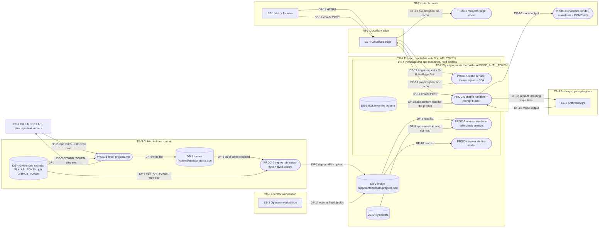

# Frame: projects page from GitHub

**Date:** 2026-11-11 · **Status:** draft (re-lock pending: previously locked at tag `brief/projects-from-github/frame-locked`, commit `d1a2633bf6b3a1a5abbd2b5c357b1115a75f3479`; the threat-model scope was added 2026-11-18 and is unsigned) · **Intake:** `docs/intent/projects-from-github.md` · **Task:** #4726

**Process.** Peter ruled "Trim, then light review" (2026-11-11). Under that ruling this change skips three steps: the threat-modeling pass, Wyrd's dry decompose and Charon's canon check. Peter later asked for an attacker list (2026-11-18: "so lets add the attacker list"), so Warden's threat-modeling pass ran on 2026-11-18; see `## Threat-model scope`. Wyrd's dry decompose and Charon's canon check remain skipped. The Frame's security content is its `## Data flow diagram`, `## Threat-model scope`, `## Floor check`, `## Threats (STRIDE summary)`, `## Known gaps` and `## Accepted and deferred risks` sections. The spec's `## Security` section maps each control to the requirement that carries it.

**Interim.** This change departs from the simplification Frame's L-4, which makes job the source of truth for all content (`docs/intent/folio-simplification-frame.md`). The departure is interim. Amending L-4 stays parked on #3554 (the coordinator's level-4 call, 2026-11-11).

## Quality-attribute scenarios

| ID | Stimulus | Environment | Response | Measure |
|---|---|---|---|---|
| QA-1 | A repo or its description changes on GitHub | the next deploy | the list is fetched fresh | the release never serves a list from an earlier run |
| QA-2 | GitHub is unreachable or its response is unusable | the deploy job | the job stops before `Deploy` | the job is red and the live release is unchanged |
| QA-3 | A visitor reads /projects and asks the AI | production | both read one file | the page and the prompt show the same set |
| QA-4 | A description carries markup | production | it is shown as text | no element is built from the description, and every link points to `https://github.com/<owner>/<name>` |
| QA-5 | A pull request runs CI | no network, no list file | tests run on committed fixtures | the existing test jobs pass, unchanged |

## Locked directions

| ID | Direction | Anchor | Rejected, and why |
|---|---|---|---|
| D-1 | The fetch runs as a new step in the CI `deploy` job, above `Deploy`. Its output goes into the build context that `flyctl deploy` uploads. A Fly release command checks the list's age on every deploy, so a manual `flyctl deploy` of a stale local file fails (Peter, 2026-11-13: "Fly release command check"). | P-GuaranteeByMechanism: a fetch inside a Docker `RUN` can reuse the builder's layer cache and ship a stale list with no signal. Measured 2026-11-13: deploy run 43460050672 logged `[frontend-builder 6/6] RUN npm run build && npm run check:csp` as CACHED on Fly's remote builder. The release command carries freshness for manual deploys as a check that fails the deploy, not a convention. | **The Docker build** (Peter's first pick for manual deploys, withdrawn 2026-11-13): the remote builder reuses cached layers, so a fetch `RUN` ships a stale list silently, and `flyctl deploy --build-secret NAME=VALUE` puts the token in argv. **A `just deploy` recipe that fetches first:** a convention, and a bare `flyctl deploy` skips it. |
| D-2 | One file, written to `frontend/static/projects.json`. The Dockerfile's frontend stage copies `frontend/` and builds it, so the file reaches the image's `frontend/build/` and is served as `/projects.json`. Writing into `frontend/build/` directly would not work, because `.dockerignore` excludes it. The page loads the file at runtime, and the server reads it at startup to build the AI context. | V-Simplicity: no new route and no Dockerfile change. G-0002: read at runtime, not embedded. Two readers of one file means QA-3 holds by construction. | **`/api/projects` serving a server-side copy:** changes the API contract and the Dockerfile. **A Vite build-time import:** the frontend build would need the file, so both test jobs would have to change. |
| D-3 | Remove `/api/projects`, `/api/projects/{slug}` and the detail page. Remove the admin projects editor, `/api/admin/projects` and the dashboard's projects count (Peter: "Remove the editor"). The `projects` table stays, with no migration. Dropping it is parked on #3554. | JTBD "Puck Playbook gone". P-GuaranteeByMechanism: an editor whose edits reach nothing is a silent failure. V-Reversibility: no migration is needed. | **Keeping the editor:** its edits would be dead writes. **Dropping the table now:** a migration the parked bundle spec already plans. |
| D-4 | Opt-out: every returned repo appears except forks, archived repos and `.github`. Validation fails closed. | Peter's "nothing else". P-SecurityLayered: "a control that errors denies rather than passes through". | **An allowlist:** a new repo would need an edit. **Skipping bad entries:** the control would fail open. |
| D-5 | Text-only rendering. Links are composed from owner and name, and no other GitHub field is held. | P-SecurityLayered: enumerate what is permitted. V-DataMinimization. | **The detail page's `{@html DOMPurify.sanitize(marked.parse(…))}`.** **GitHub's `homepage` or `html_url`.** |
| D-6 | Groups in the order `mnemra`, `prmanahan`. Repos sorted by ASCII-lowercased name, compared by code unit. | V-Simplicity: needs only the name, and the order is stable across deploys. | **Most recently pushed:** reorders on every push and needs a timestamp. |
| D-7 | An empty description shows the name only, and the deploy log names the repo. | V-Honesty: no invented text. V-Observability. | **A placeholder:** invented text. **Failing the deploy:** a missing description is not a broken fetch. |
| D-8 | The fetch authenticates with the job's built-in `GITHUB_TOKEN`. `permissions: contents: read` is unchanged, and `FLY_API_TOKEN` stays scoped to the `Deploy` step. | P-LeastAuthority: "scope a credential to the operations its role performs". | **A PAT:** a standing, account-wide credential. **No token:** shared runner addresses risk rate-limit false reds. |
| D-9 | The fetch is a plain Node script using the built-in `fetch`, with no new dependency, tested under `npm run test:unit`. Peter ruled "Node script". | This is a P-RustDefault departure that Peter granted. The script sits at `frontend/scripts/fetch-projects.mjs`, beside `frontend/scripts/check-csp.mjs`, and its tests run under vitest. | **Rust**, which canon recommended: a toolchain build in the deploy job. **`gh api` and `jq` in YAML:** untested logic. |

## Escalations, resolved 2026-11-11, 2026-11-13 and 2026-11-18

- **Admin and table:** "Remove the editor" (D-3).
- **Language:** "Node script" (D-9).
- **FL-4, secret scanning, 2026-11-18:** "Add the check now" (#4730). The check is `.githooks/pre-commit`; see FL-4 under `## Floor check`. Superseded: Peter's ruling of 2026-11-11, "Separate repo fix", which treated FL-4 as a repo-wide gap, filed as its own task, that did not block this change. It lost on 2026-11-18, when the floor's lock rule made FL-4 blocking: an item `not met` is a blocker that no decomposer override carries (`threat-modeling` skill, step 6, Floor check). With no pre-commit check, FL-4 was `not met`, so this Frame could not lock under the old ruling.
- **Other `mnemra` writers:** the coordinator measured exactly one member, prmanahan, and no outside collaborators, so no other writer exists.
- **L-4 tension:** recorded as interim, see the top of this Frame.
- **Manual deploys (spec KG-2), 2026-11-13:** "Fly release command check" (D-1).

## Data flow diagram

Typed DFD from Warden's security-mode pass, 2026-11-18, drafted against PR 74 head `46d95fc`. Processes are `PROC-n`, not the template's `P-*`, because `P-` prefixes canon principle ids; `PR-n` was also rejected, because canon has a rule `PR1` and "PR" reads as a pull request. The source names each trust boundary as a crossing. Which elements each `TB-*` subgraph encloses, and which flows cross it, is the architect's placement of those crossings. The **Trust boundaries** table is the record of both.

**External entities**

| ID | Entity |
|---|---|
| EE-1 | Visitor browser |
| EE-2 | GitHub REST API, plus repo-text authors |
| EE-3 | Operator workstation |
| EE-4 | Cloudflare edge |
| EE-5 | Anthropic API |

**Processes**

| ID | Process | Code |
|---|---|---|
| PROC-1 | fetch-projects.mjs, on the runner | `frontend/scripts/fetch-projects.mjs` |
| PROC-2 | deploy job: setup-flyctl + flyctl deploy | `.github/workflows/deploy.yml`, job `deploy` |
| PROC-3 | release machine: `folio check-projects` (R-18, R-19) | `cmd/server/main.rs`, `fly.toml` `[deploy]` |
| PROC-4 | server startup loader (R-10) | `cmd/server/main.rs`, `libs/site-core/projects_list.rs` |
| PROC-5 | static service: `/projects.json` + SPA | `libs/site-core/static_files.rs` |
| PROC-6 | chat/fit handlers + prompt builder | `libs/site-core/routes/ai.rs`, `libs/site-core/ai/context.rs` |
| PROC-7 | /projects page render, in the browser | `frontend/src/routes/(public)/projects/+page.svelte` |
| PROC-8 | chat pane render, markdown + DOMPurify, in the browser | `frontend/src/lib/chat-markdown.ts` |

**Data stores**

| ID | Store |
|---|---|
| DS-1 | runner `frontend/static/projects.json` |
| DS-2 | image `/app/frontend/build/projects.json` |
| DS-3 | SQLite on the volume |
| DS-4 | GH Actions secrets (`FLY_API_TOKEN` env, job `GITHUB_TOKEN`) |
| DS-5 | Fly secrets |

**Data flows**

| ID | From | To | Carries |
|---|---|---|---|
| DF-1 | PROC-1 | EE-2 | HTTPS GET + Bearer |
| DF-2 | EE-2 | PROC-1 | repo JSON, untrusted text |
| DF-3 | DS-4 | PROC-1 | `GITHUB_TOKEN` as step env |
| DF-4 | PROC-1 | DS-1 | write file |
| DF-5 | DS-1 | PROC-2 | build-context upload |
| DF-6 | DS-4 | PROC-2 | `FLY_API_TOKEN` as step env |
| DF-7 | PROC-2 | DS-2 | deploy API + upload |
| DF-8 | DS-2 | PROC-3 | read list |
| DF-9 | DS-5 | PROC-3 | all app secrets in env, not read |
| DF-10 | DS-2 | PROC-4 | read list |
| DF-11 | EE-1 | EE-4 | HTTPS |
| DF-12 | EE-4 | PROC-5 | origin request + `X-Folio-Edge-Auth` |
| DF-13 | PROC-5 | PROC-7, through EE-4 | `projects.json`, `no-cache` |
| DF-14 | EE-1 | PROC-6, through EE-4 | chat/fit POST |
| DF-15 | PROC-6 | EE-5 | prompt including repo lines |
| DF-16 | EE-5 | PROC-8, through PROC-6 | model output |
| DF-17 | EE-3 | DS-2 | manual `flyctl deploy` from the operator workstation |
| DF-18 | DS-3 | PROC-6 | site content read for the prompt |

**Trust boundaries.** The Boundary column is the source's. The Encloses and Crossing flows columns are the architect's placement. TB-2 sits inside TB-5, which sits inside TB-4, so a flow from outside TB-4 into TB-2 is listed against all three, and DF-18, from DS-3 inside TB-5, against TB-2 only.

| ID | Boundary | Encloses | Crossing flows |
|---|---|---|---|
| TB-1 | Internet → Cloudflare | EE-4 | DF-11, DF-12, DF-13, DF-14 |
| TB-2 | Cloudflare → Fly origin; trusts the holder of `EDGE_AUTH_TOKEN` | PROC-5, PROC-6 | DF-12, DF-13, DF-14, DF-15, DF-16, DF-18 |
| TB-3 | GitHub repo text → runner | PROC-1, PROC-2, DS-1, DS-4 | DF-1, DF-2, DF-7 |
| TB-4 | runner → Fly (`FLY_API_TOKEN`) | DS-2, DS-5, and TB-5 | DF-7, DF-12, DF-13, DF-14, DF-15, DF-16, DF-17 |
| TB-5 | Fly release/app machines (hold secrets) | PROC-3, PROC-4, DS-3, and TB-2 | DF-8, DF-9, DF-10, DF-12, DF-13, DF-14, DF-15, DF-16 |
| TB-6 | server → Anthropic (prompt egress) | EE-5 | DF-15, DF-16 |
| TB-7 | server → visitor browser | EE-1, PROC-7, PROC-8 | DF-11, DF-13, DF-14, DF-16 |
| TB-8 | operator workstation → Fly (the KG-3 routes) | EE-3 | DF-17 |

## Threat-model scope

Drafted by Warden, 2026-11-18, in security mode with the `threat-modeling` skill, against PR 74 head `46d95fc`; Peter's rulings of the same day are folded in. The intake (`docs/intent/projects-from-github.md`) has no `## Security implications (draft scope)` section, so this scope is drafted from the Frame, the spec and the repository, not from an intake draft. `[M]` marks a fact measured from the repository by Warden or the lead.

### Deployment

- **Hosting** `[M fly.toml]`. Fly.io app `folio-prmanahan`, region `yyz`, `shared-cpu-1x`, 256mb. `auto_stop_machines = "stop"`, `min_machines_running = 0`. SQLite on volume `site_data` at `/app/data`. Health check `GET /api/health`. Release command `./folio check-projects` (PR 74 head).
- **Edge.** Cloudflare at peter.manahan.io. Origin lock `[M libs/site-core/middleware/origin_lock.rs]`: every request needs the Cloudflare-injected `X-Folio-Edge-Auth`, compared by SHA-256 digest in constant time. Only `GET /api/health` is exempt. `EDGE_AUTH_TOKEN` is required at startup. The post-deploy origin-closure check expects the raw Fly origin to return 404.
- **Admin.** Bearer token checked against `admin_sessions`, 24h expiry `[M libs/site-core/auth.rs]`. `ADMIN_PASSWORD` is hashed with Argon2id at startup.
- **AI.** Chat and fit call Anthropic with a server-side key, optional and disabled when unset. Chat has no tools `[M libs/site-core/ai/anthropic_stream.rs]`. Chat output renders as markdown through `{@html}` with DOMPurify; http(s) and mailto links survive, and images are forbidden `[M frontend/src/lib/chat-markdown.ts]`.
- **CI.** GitHub Actions (`.github/workflows/deploy.yml`, `.github/workflows/test.yml`). A push to `main` runs `test`, then `deploy` (environment `production`). Deploy order: setup-flyctl; Fetch, with `GITHUB_TOKEN` as step env only; `flyctl deploy --remote-only` with `FLY_API_TOKEN`; then the health, origin-closure and CSP checks. `.dockerignore` excludes `.git/`.
- **Image** `[M Dockerfile]`. `debian:bookworm-slim`, non-root `USER app`.
- **Operator.** Peter, the sole maintainer. He deploys through CI on a merge to `main`, or by hand with `flyctl` from his workstation (EE-3).
- **Users.** Anonymous public visitors (ACTOR-1), with no account.

### Actor set

- ACTOR-1 — Anonymous internet visitor (browser, recruiter, crawler) — in — the site is public, and chat and fit take anonymous input.
- ACTOR-2 — Anonymous GitHub user or PR author; also anyone who registers a freed owner name — in — `folio` is a public repository.
- ACTOR-3 — A writer of repo text other than Peter (a `mnemra` org member, collaborator or GitHub App) — out — overkill for this project (Peter, 2026-11-18: "ok i think it is overkill for this project. we can revisit if I ever give anyone authority to create repos in mnemra"); revisit if Peter ever gives anyone authority to create repos in `mnemra`; the text validation and the prompt preamble stay, for ACTOR-4 and ACTOR-6 — retires: none.
- ACTOR-4 — Holder of Peter's GitHub credentials (phished session, stolen token) — in — adds no capability through this feature, because a push to `main` already deploys; kept for completeness.
- ACTOR-5 — Supply chain: a third-party action or tag retargeter, the flyctl release binary, a crate or npm publisher — in — the deploy job runs third-party actions in the job that holds `FLY_API_TOKEN`.
- ACTOR-6 — Peter acting by mistake: a stale manual deploy, a description with a rejected code point, a wrong `--config` — in — R-18 and R-19 exist to stop this actor.
- ACTOR-7 — Platform operators (GitHub, Cloudflare, Fly, Anthropic) acting maliciously — out — they are the trust anchor — retires: none.
- ACTOR-8 — Network attacker between the runner and api.github.com or Fly — out — HTTPS with system CAs is the control — retires: none.
- ACTOR-9 — Physical or host-level attacker on Fly or runner hardware — out — Platform responsibility — retires: none.

Not in this set: the admin-login and AI cost-abuse surface. This feature leaves it unchanged, except that R-15 removes the admin projects editor and its API. It is left to code-stage review.

### Bar

- **Likelihood.** high = needs no capability the actor lacks today, or happens by ordinary accident. medium = needs one capability that is planned or plausible in this deployment's life. low = needs a third-party or platform compromise, or several independent failures.
- **Impact.** high = credentials, secrets or code execution in production, or persistent unauthorized control of the live release. medium = misleading or hostile content delivered to visitors, or the deploy path blocked for hours. low = recoverable in minutes, with no data or content effect.
- **Above the bar: high/high, high/medium, medium/high.** Every other cell is below.

### Signatures

Reserved for the three signature lines, one each for the actor set, the bar and the known-gaps list. The lead writes them here in the lock commit only, each followed by Peter's answer verbatim. None is written, so this scope is unsigned.

## Floor check

- **FL-1 Secrets at rest** — met for this change. Pre-existing and outside #4726: `libs/site-core/config.rs:58`, `dotenvy::dotenv().ok()`, loads `.env` with no owner-only permission check; the lead files it as a separate task.
- **FL-2 Secrets read once** — met on PR 74's branch. `persist-credentials: false` is set on all four checkouts (the `test` and `deploy` jobs of `deploy.yml`, both jobs of `test.yml`) and pinned by R-7 (Peter, 2026-11-18: "exend the fix", "Require and pin"). `audit.yml` already had it. Held by R-7's test, `frontend/src/lib/__tests__/deploy-workflow.test.ts`, block `R-7: action pins and checkout pin, over deploy.yml and test.yml` (added in commit `4970dc8`). Its control asserts a checkout step in each of the four jobs and in no other, each with `with` deep-equal to `{persist-credentials: false}`, the value a boolean. Its seeds fail on each of the four steps with `with:` removed, the flag `true`, the flag the string `'false'`, an added `token:` key, or an added `fetch-depth:` key. A bumped checkout version with no `with:` also fails.
- **FL-3 Redaction and loud failure** — met. The fetch script never logs `err.message`. The validator's `Display` uses `{:?}`. A 401 or 403 fails the run (R-2).
- **FL-4 Secret detection** — met. The floor text (`threat-modeling` skill) reads: "A pre-commit secret check runs; detection beyond it goes as far as the repository's hosting allows, and the remaining gap is named." **Pre-commit check:** `.githooks/pre-commit` (#4730; Peter, 2026-11-18: "Add the check now"), installed by `just hooks`. It runs `gitleaks git --staged --redact` and fails closed. Each of these refuses the commit: a missing `gitleaks` binary, an unreadable staged set, a finding, any other non-zero `gitleaks` exit, and an `ERR` line on stderr. Measured by Bolt, 2026-11-18: the hook refused a staged AWS-style fake key; it refused when `gitleaks` was absent from PATH; a history scan found 0 findings in 142 commits. **Hosting:** GitHub secret scanning and push protection. Measured by the lead, 2026-11-18, with `gh api repos/prmanahan/folio --jq .security_and_analysis`: `secret_scanning` enabled, `secret_scanning_push_protection` enabled. That measurement superseded Warden's draft "not met", which was written without it. **Remaining gap:** the hook is per-clone, and only `just hooks` installs it, so nothing fails on a clone that never ran `just hooks`. It covers `git commit` only, and `git commit --no-verify` bypasses it. `just secret-scan`, the full history and working-tree scan, runs by hand and in no gate.
- **FL-5 Store isolation** — met, inherited and unmeasured. `FLY_API_TOKEN` is an environment-scoped secret, `main`-only, a deploy token for one app.

## Threats (STRIDE summary)

In-scope actors only, rated against the bar above. TH-5 and TH-9 are absent because Warden's draft folded them into other rows. TH-13 (PROC-6 D, an unbounded repo count inflating every prompt) is omitted because its only actor, ACTOR-3, is out of scope.

| ID | Element | STRIDE | Threat | Actor | L/I | Bar | Disposition |
|---|---|---|---|---|---|---|---|
| TH-1 | EE-2 | S | Owner-name takeover after Peter renames or deletes `mnemra` or `prmanahan` | ACTOR-2 | low/medium | below | known gap, KG-5 |
| TH-2 | EE-2 | R | No record of what description text shipped; R-6 logs no descriptions | ACTOR-4 | low/low | below | known gap, KG-9 |
| TH-3 | PROC-1 | I | The token reaches a non-GitHub host or a log | ACTOR-4, ACTOR-5 | low/low | below | mitigated: R-1 (two hard-coded URLs, `redirect: 'error'`, same-origin `next` links, 10-page cap) and R-5 |
| TH-4 | PROC-1, PROC-3 | D | A bad description, name or fork blocks every deploy (emoji with U+FE0F or U+200D fail the invisible-character table) | ACTOR-6 | high/low | below | fail-closed by design (D-4, R-4), covered by R-2 and R-6; the break-glass is not written down, known gap KG-4 |
| TH-6 | DS-1 | T | Another step rewrites `projects.json` between fetch and deploy | ACTOR-5 | low/high | below | dominated by TH-7; R-10 and R-18 validate shape |
| TH-7 | PROC-2 | E, I | A tag-retargeted action or binary runs in the `FLY_API_TOKEN` job | ACTOR-5 | low/high | below | mitigated: every `uses:` pinned by commit SHA and flyctl pinned to 0.5.10 (Peter, 2026-11-18: "fix it, pin by hash"). Held by R-7's test, `frontend/src/lib/__tests__/deploy-workflow.test.ts` (added in commit `4970dc8`). In both workflows, every `uses:` must equal a pair on an exact `<path>@<40-hex SHA>` allowlist of the five Base actions, and the `setup-flyctl` step's `with.version` must be an exact `x.y.z` string. The test does not name `0.5.10`. That value is set in `.github/workflows/deploy.yml`, so changing the `flyctl` version takes a visible workflow edit |
| TH-8 | PROC-2 | T | The deploy command or token scope is altered | ACTOR-2 via PR, ACTOR-6 | low/high | below | mitigated: R-7's structural test and the `production` environment's `main`-only policy |
| TH-10 | PROC-3 | I | The release machine holds every app secret in env (documented Fly behaviour) | ACTOR-5, ACTOR-4 | low/high | below | mitigated: R-18 reads none of them |
| TH-14 | PROC-4 | D, T | A bad list crash-loops a machine | ACTOR-6 | low/medium | below | covered by R-10 and R-18. Whether Fly keeps the old release serving when the new one crashes is unverified; the same premise is recorded in `docs/RISK-REGISTER.md` RISK-2 |
| TH-11 | PROC-5 | D | `/projects.json` is `no-cache` and sits outside the app rate limiter (`libs/site-core/app.rs:89`) | ACTOR-1 | medium/low | below | known gap, KG-9 |
| TH-12 | PROC-6, PROC-8 | T, E | A description steers the AI, and its reply can carry a clickable link to any http(s) host | ACTOR-4 | medium/medium | below | known gap, KG-6. Guarded only by R-4 and R-10 (350 code points, no invisible characters, one line) and the R-12 preamble. No AI/LLM review lens exists, so this rating is structural |
| TH-15 | PROC-7 | T | Markup in a description | — | low/low | below | covered by R-14 (text only) and R-13 (composed links) |

## Known gaps

- **KG-1, a second writer on the repos.** Measured 2026-11-11 by the coordinator: the `mnemra` org has one member and no outside collaborators, and `prmanahan/folio`, `sigil` and `factor` list only prmanahan as collaborator. GitHub App installations are unmeasured, because listing them returned 403 for a non-App token. The trigger announces itself, since only Peter can add a member, a collaborator or an App. **Signed by Peter, 2026-11-13.**
- **KG-3, deliberate routes around R-18.** Each ships whatever `projects.json` its image holds, however old: (a) `flyctl deploy --skip-release-command`, which is also the emergency rollback route; (b) a manual deploy using another `--config` file, or a local `fly.toml` without `[deploy]`; (c) machine-level commands such as `fly machine update --image` or `fly machine run` (from reviewer knowledge, not measured). A plain `flyctl deploy`, a CI deploy (R-7) and `flyctl deploy --image` all run the check (documented Fly behaviour, confirmed at the first real run). Rejected (Peter, 2026-11-13): a scheduled detector for an out-of-band deploy. **Signed by Peter, 2026-11-13.**
- KG-4 — PROC-1, PROC-3 D (TH-4) — A bad description, name or fork, or a GitHub failure, blocks every deploy — ACTOR-6 — high/low — Fail-closed by design (D-4, R-4); the recovery route is not written down.
- KG-5 — EE-2 S (TH-1) — An owner name freed by rename or delete is registered by another account and passes R-4's owner check — ACTOR-2 — low/medium — Needs Peter to rename or delete `mnemra` or `prmanahan` first.
- KG-6 — PROC-6, PROC-8 T, E (TH-12) — One plain line of description text can steer the AI, and its output can carry a clickable link to any http(s) host — ACTOR-4 — medium/medium — Guarded only by R-12's preamble. This replaces the spec's unsigned Security "Residual" sentence.
- KG-9 — PROC-5 D (TH-11); EE-2 R (TH-2) — `/projects.json` sits outside the app's rate limiter, and descriptions are never logged — ACTOR-1 medium/low; ACTOR-4 low/low — Both below the bar.

Not on the list: KG-2, closed 2026-11-13 by R-18 and R-19; KG-7, dropped with ACTOR-3; KG-8, fixed by the SHA pins (TH-7).

## Accepted and deferred risks

None. No threat in the summary rates above the bar, so no `docs/RISK-REGISTER.md` entry is needed.

## Intent self-report

I read the JTBD as one list of the two owners' public repos, fetched on every deploy and read the same way by the page and the AI. D-3 removes the detail pages, which the read-back did not mention. I took that from "Puck Playbook gone" and "just list".

## Carried review findings (decomposer override)

None.
